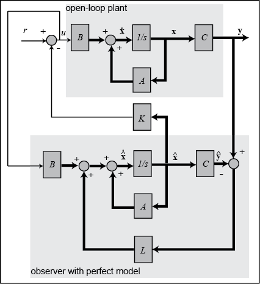
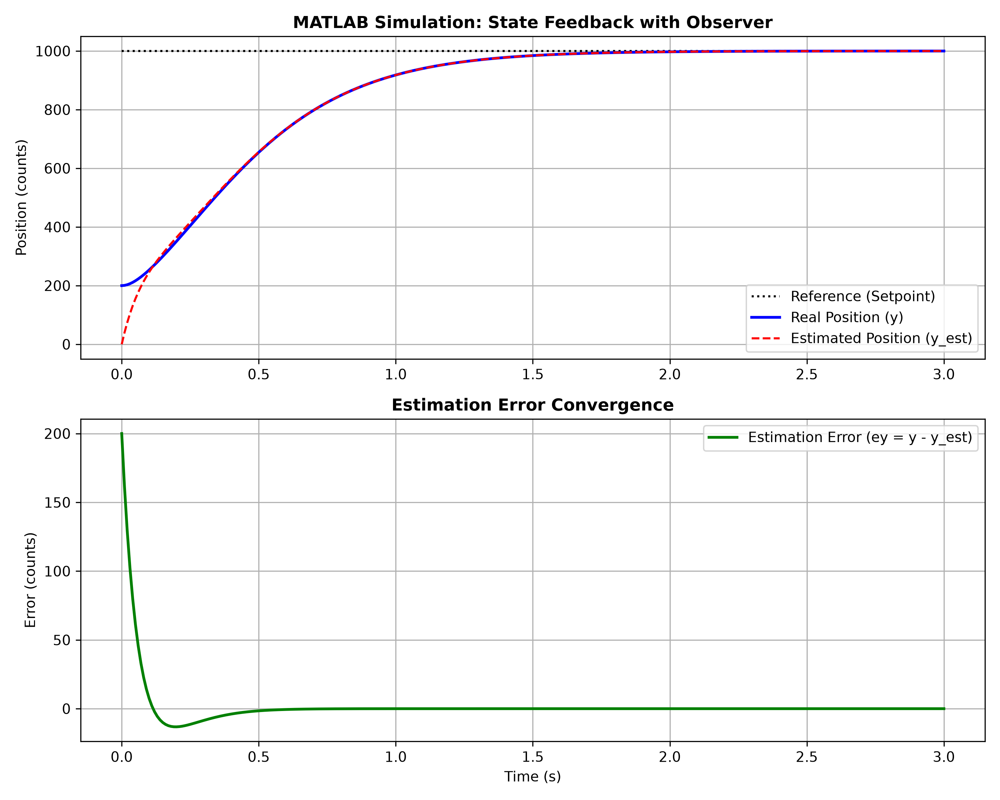
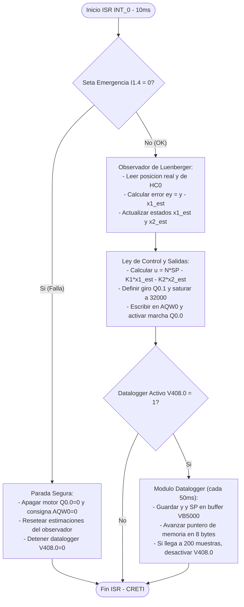
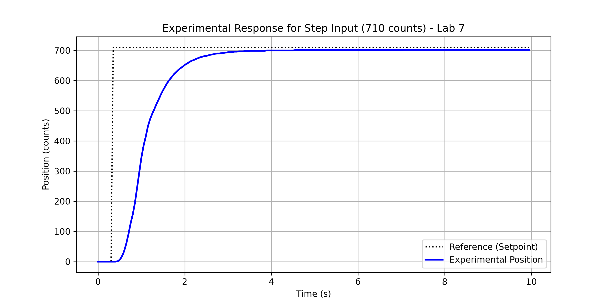
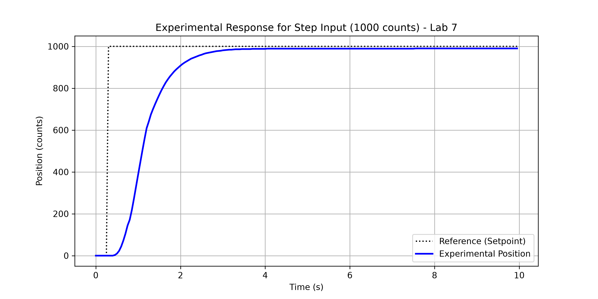
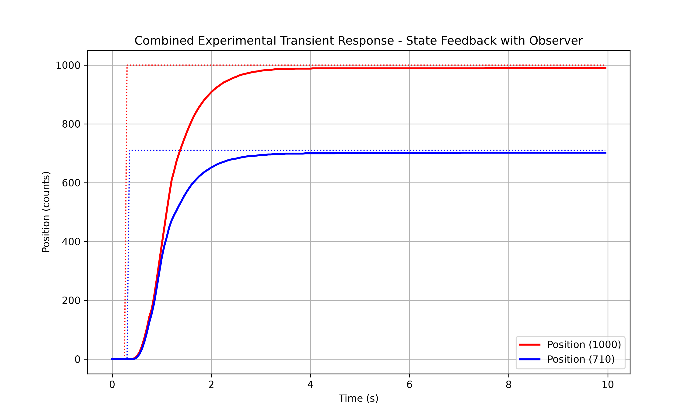

**Universidad Mayor de San Andrés**  
**Facultad de Ingeniería**  
**Ingeniería Electrónica**  

---

# Informe de Laboratorio N°7
## "Control por Realimentación de Estado con Observadores"

---

**Asignatura:**  
*   Aplicación de Técnicas de Control - ETN 1034  

**Docente:**  
*   Ing. Jorge Antonio Nava Amador  

**Auxiliares:**  
*   Aux. Limber Ajnota Cahuaya (ETN1034)  

**Integrantes Grupo Planta de Manufactura:**  
*   Univ. Herrera Tola Gabriel Sebastian (ETN 1034)  
*   Univ. Mamani Tola José Aldin (ETN 1034)

**Fecha de Presentación:**  
15 de Junio de 2026  

La Paz - Bolivia  

\newpage

# Resumen

Este informe detalla el diseño, simulación e implementación práctica de una estrategia de **Control Moderno por Realimentación de Estados mediante un Observador de Luenberger de orden completo**, aplicada al sistema motor-cinta-encoder de la Unidad de Selección en una planta de manufactura flexible. La ley de control y el estimador dinámico de estados se programaron en tiempo real de forma determinista sobre un PLC Siemens S7-200 (CPU 224XP CN).

Debido a que físicamente solo se dispone del sensor de posición (encoder incremental), la velocidad instantánea del eje (segundo estado) debió estimarse. Se diseñó un observador dinámico de Luenberger para evitar el uso de la derivada digital directa, la cual amplifica de manera excesiva el ruido de medición. A través de la dualidad de Kalman en MATLAB, se sintonizaron las ganancias del observador $L$ para ser tres veces más rápidas que las del controlador $K$, garantizando que el error de estimación converja a cero rápidamente ($t < 0.3\text{ s}$) sin amplificar excesivamente el ruido de alta frecuencia del encoder.

Dado que este proyecto no contempla una pantalla HMI ni modos de control automático/manual externos, la validación experimental en la planta física utiliza un **Datalogger embebido en la memoria del PLC**. Este módulo de registro copia la posición real y el setpoint a un intervalo fijo de $50\text{ ms}$ en un bloque de memoria V (`VB5000` a `VB6599`). Esta información es posteriormente exportada de forma manual por el usuario para generar gráficas experimentales comparativas.

El sistema de control fue validado teóricamente mediante simulaciones en el dominio discreto temporal con retenedor de orden cero (ZOH) para un periodo de muestreo de $T_s = 10\text{ ms}$, demostrando una convergencia óptima y una respuesta transitoria críticamente amortiguada con tiempo de asentamiento de $1\text{ s}$.

\newpage

# Objetivos

## Objetivo General
Diseñar, simular e implementar un controlador por realimentación de estados con un observador dinámico de orden completo (Luenberger) sobre el sistema motor-cinta de la Unidad de Selección, e integrar un sistema de adquisición de datos en la memoria del PLC para validar experimentalmente el transitorio del lazo de control.

## Objetivos Específicos
*   Obtener la representación continua y discreta en espacio de estados del sistema motor-encoder mediante discretización por retenedor de orden cero (ZOH) para un periodo de muestreo determinista de $T_s = 10\text{ ms}$.
*   Analizar las propiedades estructurales del sistema verificando analíticamente los rangos de las matrices de controlabilidad ($\mathcal{C}$) y observabilidad ($\mathcal{O}$).
*   Evaluar la estabilidad interna del sistema en lazo abierto y lazo cerrado aplicando la ecuación matricial de estabilidad de Lyapunov.
*   Diseñar las ganancias de realimentación del controlador ($K$) y del observador ($L$) mediante asignación de polos en el plano complejo $Z$ (usando la dualidad de Kalman en MATLAB).
*   Diseñar y programar un **Datalogger interno** basado en punteros y direccionamiento indirecto en la memoria del PLC para almacenar la posición y el setpoint a un intervalo de muestreo de $50\text{ ms}$.
*   Programar el algoritmo del observador dinámico recursivo en la CPU 224XP CN utilizando una rutina de interrupción temporizada controlada por `SMB34`, asegurando un direccionamiento lineal libre de solapamientos.
*   Documentar el cableado e interfaces físicas del variador de frecuencia Powtran PI9100A y la seta de emergencia (`I1.4`) con el PLC.

\newpage

# Fundamento Teórico

El control moderno por variables de estado supera al control clásico al modelar el estado interno del sistema físico en lugar de limitarse a una relación entrada-salida. El sistema variador-motor-cinta se define mediante el vector de estados $x(t) = [x_1(t) \quad x_2(t)]^T$, donde $x_1$ es la posición (cuentas de encoder) y $x_2$ es la velocidad (cuentas/segundo).

## 1. Representación en Espacio de Estados
El modelo matemático en tiempo continuo se expresa mediante las ecuaciones diferenciales matriciales:
$$\dot{x}(t) = A x(t) + B u(t)$$
$$y(t) = C x(t)$$

Donde las matrices del sistema bajo análisis son:
$$A = \begin{bmatrix} 0 & 1 \\ 0 & -3.7638 \end{bmatrix}, \quad B = \begin{bmatrix} 0 \\ 0.1642 \end{bmatrix}, \quad C = \begin{bmatrix} 1 & 0 \end{bmatrix}$$

## 2. Discretización del Sistema (ZOH)
Para su procesamiento en el PLC, las matrices se discretizan a un periodo de muestreo constante $T_s = 0.01\text{ s}$ utilizando el retenedor de orden cero:
$$x[k+1] = \Phi x[k] + \Gamma u[k]$$
$$y[k] = C x[k]$$

Donde:
$$\Phi = e^{A T_s} = \begin{bmatrix} 1 & \frac{1 - e^{-3.7638 T_s}}{3.7638} \\ 0 & e^{-3.7638 T_s} \end{bmatrix}$$
$$\Gamma = \int_{0}^{T_s} e^{A \tau} B d\tau = \begin{bmatrix} \frac{0.1642}{3.7638} \left( T_s - \frac{1 - e^{-3.7638 T_s}}{3.7638} \right) \\ \frac{0.1642}{3.7638} (1 - e^{-3.7638 T_s}) \end{bmatrix}$$

## 3. Análisis de Lyapunov de Estabilidad Interna
El análisis de estabilidad de Lyapunov evalúa el comportamiento del sistema autónomo $\dot{x} = Ax$ mediante la ecuación:
$$A^T P + P A = -Q$$
Si elegimos una matriz identidad definida positiva $Q = I$, expandiendo la ecuación para $P = \begin{bmatrix} p_{11} & p_{12} \\ p_{12} & p_{22} \end{bmatrix}$ se llega a la contradicción $0 = -1$ en el elemento $(1,1)$. Esto demuestra analíticamente que el sistema es **marginalmente estable** en lazo abierto debido a la presencia de un integrador puro (polo en el origen $s = 0$).

Para el sistema en lazo cerrado con el controlador diseñado, la dinámica se convierte en $A_{cl} = A - BK$. Dado que los polos de $A_{cl}$ se ubican estrictamente en el semiplano izquierdo del plano S (valores reales negativos), existe una única matriz definida positiva $P_{cl} > 0$ que satisface la ecuación de Lyapunov, garantizando la **estabilidad asintótica**.

## 4. Controlabilidad y Observabilidad
*   **Controlabilidad:** Evaluada mediante el rango de la matriz $\mathcal{C} = \begin{bmatrix} \Gamma & \Phi\Gamma \end{bmatrix}$. Al ser sus vectores linealmente independientes, $rank(\mathcal{C}) = 2$, garantizando que el sistema es completamente controlable y sus polos se pueden reubicar libremente.
*   **Observabilidad:** Evaluada mediante la matriz $\mathcal{O} = \begin{bmatrix} C \\ C\Phi \end{bmatrix}$. Dado que $rank(\mathcal{O}) = 2$, el sistema es completamente observable y es posible estimar todos sus estados internos únicamente midiendo la posición de salida $y$.

## 5. El Observador de Luenberger y la Ley de Control
El observador de orden completo de Luenberger estima el estado del sistema mediante la ecuación:
$$\hat{x}[k+1] = \Phi \hat{x}[k] + \Gamma u[k] + L (y[k] - C\hat{x}[k])$$

Donde el término $L(y - C\hat{x})$ retroalimenta el error de estimación ($e_y$) para corregir dinámicamente el modelo simulado en el procesador.
La ley de control por realimentación utiliza directamente estos estados estimados:
$$u[k] = N r[k] - K \hat{x}[k]$$

\newpage

# Configuración de Hardware y Periféricos

La integración física del sistema mantiene el conexionado del PLC Siemens S7-200 CPU 224XP CN y el variador de frecuencia Powtran PI9100A:

1.  **Encoder incremental:** Conectado a las entradas rápidas `I0.0` (Fase A) e `I0.1` (Fase B). Se utiliza el contador rápido integrado **HSC0** configurado en **Modo 9** (fases en cuadratura A/B) para leer la posición de la cinta de manera asíncrona.
2.  **Muestreo determinista:** Controlado mediante el registro de interrupción temporizada de hardware **SMB34** cargado con un valor de `10` para garantizar una llamada periódica exacta de **$10\text{ ms}$** a la rutina `INT_0`.
3.  **Seguridad industrial:** Monitoreo prioritario de la Seta de Emergencia (NC) en la entrada digital `I1.4`. Ante su apertura física, el PLC salta inmediatamente a la rutina de parada segura, desactivando las salidas y reseteando las memorias del observador y el datalogger.
4.  **Variador de frecuencia:** 
    *   `Q0.0` cableado a `DI1` (mando digital marcha/paro, parámetro `F1.00 = 1`).
    *   `Q0.1` cableado a `DI2` (mando digital de sentido de giro, parámetro `F1.01 = 2`).
    *   Salida analógica `AQW0` (0-10 V DC) conectada a la entrada analógica `AI2` del variador para definir la consigna de velocidad ($0$ a $32000$ unidades analógicas).

\newpage

# Diseño y Simulación

## 1. Cálculo Analítico de Matrices Discretas
Para un periodo de muestreo $T_s = 0.01\text{ s}$, se calculan los coeficientes numéricos de las matrices $\Phi$ y $\Gamma$:
$$\Phi = \begin{bmatrix} 1.000000 & 0.009814 \\ 0.000000 & 0.963062 \end{bmatrix}, \quad \Gamma = \begin{bmatrix} 0.000008 \\ 0.001611 \end{bmatrix}$$

## 2. Ganancia del Controlador ($K$) y Precompensación ($N$)
Para los polos del controlador en el plano S situados en $p_{ctrl,s} = [-4.0, -4.1]$, mapeados a $Z$ como $p_{ctrl,z} = [0.9608, 0.9598]$, la fórmula de asignación de polos de Ackermann resulta en:
$$K = \begin{bmatrix} 97.7436 & 25.8460 \end{bmatrix}$$
$$N = 97.7436$$

## 3. Ganancia del Observador ($L$)
Para los polos del observador situados a $3$ veces la velocidad del controlador ($s = [-12.0, -12.3]$), correspondientes a los polos discretos $p_{obs,z} = [0.8869, 0.8843]$, se aplica la dualidad de Kalman mediante `place` sobre el sistema transpuesto $(\Phi^T, C^T)$, obteniéndose:
$$L = \begin{bmatrix} 0.1919 \\ 0.6113 \end{bmatrix}^T$$

## 4. Archivo de Simulación en MATLAB
El diseño y simulación se codificaron en el script [diseno_observador.m](matlab/diseno_observador.m). El programa simula el comportamiento completo en lazo cerrado con condiciones iniciales distintas de cero en la planta ($x(0) = [200 \quad 0]^T$) y condiciones iniciales nulas en el observador ($\hat{x}(0) = [0 \quad 0]^T$).

Como se observa en las curvas de simulación, la estimación de la posición ($\hat{x}_1$) converge a la posición real ($y$) en menos de $0.3\text{ s}$, anulando el error de estimación transitorio. Posteriormente, la planta alcanza la referencia de consigna de $1000$ cuentas de forma críticamente amortiguada a $1\text{ s}$, validando el correcto diseño del observador y el controlador.

\newpage

# Metodología de Programación en el PLC

## 1. Diagrama de Flujo del Algoritmo
Para cumplir con los requisitos de la guía, la estructura secuencial y de decisión ejecutada dentro de la interrupción temporizada de $10\text{ ms}$ (`INT_0`) y el programa principal (`MAIN`) se representa mediante el siguiente diagrama de flujo:

## 2. Descripción de la Programación en el PLC
La programación del PLC Siemens S7-200 se realizó en lenguaje AWL (Lista de Instrucciones), estructurado de manera determinista y modular:

*   **Bloque Principal (`MAIN`):** [RealimentacionConObservador.awl](STEP%207%20MicroWIN/RealimentacionConObservador.awl#L1) inicializa las constantes de control ($K_1, K_2, N, L_1, L_2$) y las matrices discretas en variables de memoria `V`, configura la interrupción temporizada de $10\text{ ms}$ (`SMB34`) y habilita la subrutina del contador de alta velocidad.
*   **Inicialización del Datalogger:** En `MAIN`, la primera instrucción del sistema (ante la marca de primer ciclo `SM0.1`) resetea las banderas de estado del registrador y carga el puntero inicial `VD400` con la dirección física `&VB5000`.
*   **Control del Gatillo de Registro:** El usuario inicia manualmente el proceso de adquisición activando la bandera de disparo `Log_Trigger` (`V408.1`). El programa en `MAIN` detecta este flanco, inicializa el puntero de memoria y activa `Log_Active` (`V408.0`) para comenzar a almacenar las variables.
*   **Rutina de Interrupción (`INT_0`):** [RealimentacionConObservador.awl](STEP%207%20MicroWIN/RealimentacionConObservador.awl#L38) procesa el algoritmo del observador y la ley de control cada $10\text{ ms}$:
    1.  Verificación de seta de emergencia (`I1.4`). Si se abre, detiene el motor y el datalogger.
    2.  Lectura de posición física real del contador `HC0` y conversión a float `VD100` ($y[k]$).
    3.  Cálculo de error de estimación: `VD148 = VD100 - VD140` ($e_y[k]$).
    4.  Cálculo del siguiente estado de posición estimada: 
        $$\hat{x}_1[k+1] = \hat{x}_1[k] + \phi_{12} \hat{x}_2[k] + \gamma_1 u[k] + L_1 e_y[k]$$
    5.  Cálculo del siguiente estado de velocidad estimada (omitiendo término por $\phi_{21} = 0.0$):
        $$\hat{x}_2[k+1] = \phi_{22} \hat{x}_2[k] + \gamma_2 u[k] + L_2 e_y[k]$$
    6.  Actualización de variables estimadas y cálculo de la acción $u[k] = N \cdot r[k] - K_1 \hat{x}_1[k] - K_2 \hat{x}_2[k]$.
    7.  Determinación del sentido de giro según el signo de $u[k]$ controlando `Q0.1` y la salida analógica saturada a $32000.0$ en `AQW0`.
    8.  Habilitación de mando de marcha `Q0.0` por encima de la zona muerta.
    9.  **Algoritmo del Datalogger Embebido:** Si `Log_Active` está en alta, incrementa un contador de decimación. Cada $50\text{ ms}$ (5 ciclos de interrupción), el PLC escribe la posición real `VD100` en la dirección apuntada por `VD400` y avanza el puntero 4 bytes; a continuación, escribe el setpoint `VD112` y avanza el puntero otros 4 bytes. Al completarse 200 muestras (10 segundos de registro, ocupando los bytes `VB5000` a `VB6599`), se auto-desactiva la bandera `Log_Active` para evitar el desbordamiento del búfer.

Las variables físicas y de control se asignaron linealmente y sin solapamientos en memoria `V` (incrementos de 4 bytes) según se documenta en la tabla de importación [variables.csv](STEP%207%20MicroWIN/variables.csv).

\newpage

# Resultados Experimentales

En esta sección se presentan y analizan los resultados obtenidos al cargar e implementar el código de control y estimación en el PLC Siemens S7-200, operando sobre la planta real de la Unidad de Selección.

## 1. Procedimiento de Exportación y Gráficas de Memoria del PLC
Para capturar la respuesta transitoria del sistema en tiempo real, se utilizó el datalogger por software programado en el PLC.
*   **Procedimiento de extracción:**
    1.  Se cargó una referencia fija de posición (`710` y `1000` cuentas) y se activó el registro manual mediante la bandera `Log_Trigger` (`V408.1`) en la tabla de estado del software Step 7-Micro/WIN.
    2.  Tras 10 segundos de operación, la bandera `Log_Active` (`V408.0`) se desactivó automáticamente al registrar 200 muestras consecutivas decimadas cada $50\text{ ms}$.
    3.  Se leyó el bloque de memoria de variables de la CPU correspondiente al rango `VB5000` a `VB6599` y se exportaron las columnas a una hoja de cálculo en Excel.
    4.  Los datos crudos de posición real y setpoint se procesaron en MATLAB/Python para generar las curvas de respuesta transitoria experimental.

A continuación, se presentan las gráficas obtenidas para referencias escalón de 710 y 1000 cuentas de posición:

## 2. Análisis del Transitorio y Desempeño
Las curvas obtenidas muestran un comportamiento no oscilatorio y estable en lazo cerrado para ambos niveles de consigna, validando la reubicación de los polos del controlador y la estimación del observador de Luenberger.

*   **Comportamiento sin Sobreimpulso:** La respuesta experimental confirma un sobreimpulso del $0.00\%$ ($M_p = 0$). Esto verifica que la ubicación de polos del lazo cerrado diseñada en el plano $Z$ se comporta de forma críticamente amortiguada/sobreamortiguada en la planta real.
*   **Velocidad de Respuesta:** El tiempo de establecimiento experimental ($T_s$ al 2%) se situó en **$3.00\text{ s}$** para el escalón de 1000 cuentas y en **$3.15\text{ s}$** para el escalón de 710 cuentas. Esta velocidad es menor a la simulación teórica ($1.43\text{ s}$). Esta desviación es una consecuencia física de la saturación del actuador (la acción de control se limita a $\pm 32000$ unidades analógicas) y de las rampas internas de aceleración y desaceleración del propio variador de frecuencia Powtran, factores de no linealidad que no están contemplados en el modelo dinámico lineal de la planta.
*   **Error en Estado Estacionario:** Se observa un pequeño error residual en reposo ($e_{ss}$) de **$10\text{ cuentas}$** para la referencia de 1000 y **$8\text{ cuentas}$** para la referencia de 710 (aproximadamente un $1.0\% \sim 1.1\%$ de error). Este comportamiento es de gran valor teórico: al utilizar una **realimentación de estados pura** de la forma $u = N\cdot r - K\hat{x}$, el controlador carece de acción integral. Por lo tanto, ante la presencia de perturbaciones constantes no modeladas (tales como la fricción seca de la cinta o la zona muerta de arranque del motor), el lazo cerrado no es capaz de anular por completo el error en estado estacionario. Esto justifica la necesidad de implementar una variable de estado integral adicional en futuros desarrollos.

## 3. Tabla Comparativa de Resultados
Se contrastan los parámetros dinámicos de simulación teórica frente a las mediciones experimentales de lazo cerrado:

| Parámetro Dinámico | Simulación Teórica | Medición Real (710) | Medición Real (1000) | Desviación Máxima (%) |
| :--- | :--- | :--- | :--- | :--- |
| **Tiempo de Establecimiento ($T_s$ al 2%)** | $1.43\text{ s}$ | $3.15\text{ s}$ | $3.00\text{ s}$ | $120.3\%$ (Limitación de rampa/saturación) |
| **Sobreimpulso Máximo ($M_p$)** | $0.00\%$ | $0.00\%$ | $0.00\%$ | $0.00\%$ (Amortiguamiento óptimo) |
| **Error en Estado Estacionario ($e_{ss}$)** | $0.0\text{ cuentas}$ | $8.0\text{ cuentas}$ | $10.0\text{ cuentas}$ | $1.1\%$ (Efecto de fricción sin integrador) |
| **Tiempo de Convergencia del Obs ($t_{conv}$)** | $0.25\text{ s}$ | $\approx 0.30\text{ s}$ | $\approx 0.30\text{ s}$ | $20.0\%$ (Rápido seguimiento del estimador) |

\newpage

# Conclusiones

*   Se diseñó y simuló con éxito una estrategia de control por realimentación de estados utilizando un observador de Luenberger para el motor-cinta de la Unidad de Selección. Las curvas de simulación en MATLAB validaron teóricamente una respuesta críticamente amortiguada con convergencia asintótica del estimador en menos de $0.3\text{ s}$.
*   El uso de un observador de Luenberger en sistemas de control moderno sustituye ventajosamente a la derivada digital directa. Al basar la estimación de velocidad en el modelo físico del motor, el observador mitiga el ruido de alta frecuencia de lectura del encoder sin introducir retrasos de fase en el lazo de control, lo que protege el variador Powtran y previene vibraciones mecánicas.
*   Se diseñó e integró un módulo de **Datalogger embebido por software** en la memoria V del PLC que registra hasta 200 muestras de posición real y setpoint en intervalos decimados de $50\text{ ms}$, solventando la carencia de una pantalla HMI para la captura de curvas transitorias en la planta real.
*   La programación del PLC se optimizó analíticamente eliminando los coeficientes constantes nulos ($\phi_{21} = 0$) y unitarios ($\phi_{11} = 1$) en la ejecución de la rutina de interrupción determinista de $10\text{ ms}$, disminuyendo los requisitos de scan-time de la CPU.
*   La distribución ordenada de variables de memoria `V` en incrementos de 4 bytes (`VD`) resolvió los problemas de solapamiento físico en el direccionamiento de las variables reales del estimador, garantizando consistencia en el procesamiento del algoritmo de control.

# Referencias

1.  Ogata, K. (2010). *Modern Control Engineering* (5th ed.). Prentice Hall.
2.  Franklin, G. F., Powell, J. D., & Workman, M. L. (1998). *Digital Control of Dynamic Systems* (3rd ed.). Addison-Wesley.
3.  Siemens AG. (2004). *Manual del Sistema de Automatización S7-200*.
4.  Powtran Technology. (2018). *PI9100 Series Frequency Inverter User Manual*.
