# Aportes y Recomendaciones Técnicas
## Planta de Manufactura Flexible XK-335B — Gestión I/2026

**Expositores:**
* Univ. Herrera Tola Gabriel Sebastian (ETN1034)
* Univ. Mamani Tola José Aldin (ETN1034)
* Univ. Quispe Mamani Leonardo Darwin (ETN902)
* Univ. Monzon Hidalgo Josue (ETN902)

**Docente:** Ing. Jorge Antonio Nava Amador
**Auxiliares:** Aux. Limber Ajnota Cahuaya / Aux. Fabian Plata Vargas

---

# 1. Habilitación de STEP 7 en Español (S7-200 CN)
*   **El Problema:** La CPU S7-200 CN de fabricación china obligaba a los semestres anteriores a cambiar el idioma del software Step 7-Micro/WIN al idioma chino mandarín. Trabajar con menús y opciones en este idioma ralentizaba la programación y generaba constantes fallos de carga.
*   **El Aporte:** Identificación del archivo `resk.dll` (librería del idioma chino de Step 7). Se realizó una copia de la librería española (`ResD.dll`) y se la renombró como `resk.dll` en los archivos de instalación.
*   **Resultado:** El entorno del PLC permanece en "idioma chino" ante la CPU, pero toda la interfaz visual y de texto se visualiza en español nativo.

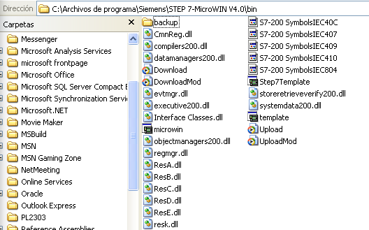

---

# 2. Toma de Datos mediante Contadores Rápidos (HSC)
*   **El Problema:** Documentación previa recomendaba construir circuitos caseros de conversión frecuencia-voltaje (VFC) para adquirir la curva dinámica de velocidad. Esto generaba errores de calibración y alta sensibilidad al ruido electromecánico de la planta.
*   **El Aporte:** Se prescindió de circuitos caseros y se programó de forma nativa la lectura del encoder trifásico a través de los **Contadores de Alta Velocidad (HSC)** de la CPU.
*   **Resultado:** Utilizando una interrupción temporizada cíclica estricta a 10ms (`SMB34`), se guardaron directamente los valores acumulados de posición en marcas de doble palabra del PLC, logrando una discretización limpia y fiel para calcular la función de transferencia real.

---

# 3. Control de Sentido de Giro en Variador Powtran
*   **El Problema:** La instalación eléctrica legacy en la unidad de Selección (Estación 5) limitaba la interacción del variador Powtran a dos líneas: marcha/paro digital en `Q0.0` y consigna analógica (0-10V) en `AQW0`, impidiendo el retroceso.
*   **El Aporte:** Se cableó una tercera línea física conectada a la salida **`Q0.1` del PLC** para actuar como el **bit de control de sentido de giro** y se reprogramó el mapa de parámetros del variador **POWTRAN**.
*   **Resultado:** Control bidireccional que permitió verificar en la práctica el desempeño y las oscilaciones subamortiguadas de los controladores diseñados en MATLAB.

  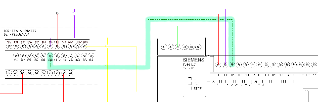
  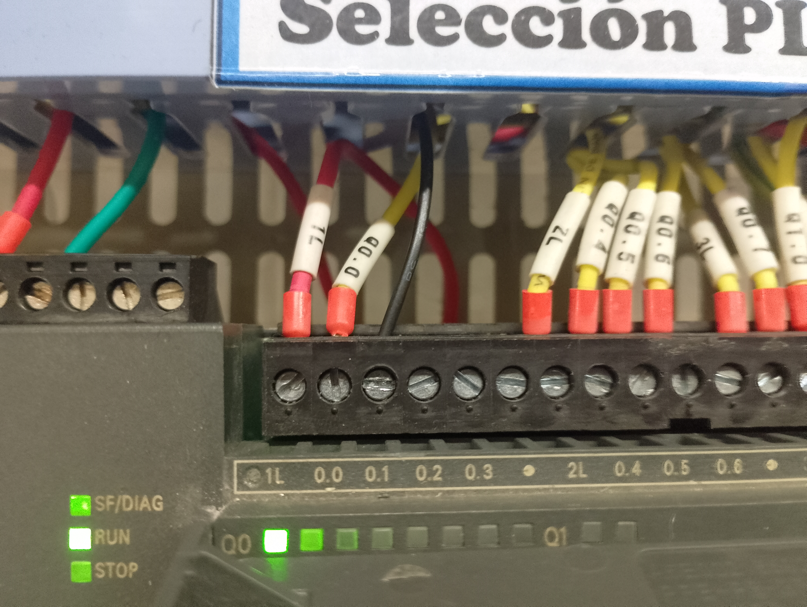

---

# 4. Solución al Direccionamiento del Servodriver
*   **El Problema:** En la Unidad de Transporte (Estación 1), el bit físico de sentido de giro (dirección) del driver Panasonic estaba conectado físicamente en la salida `Q0.1` del PLC, mientras que la librería estándar de control por PTO de Step 7 la esperaba estrictamente en la salida **`Q0.2`**.
*   *Consecuencia Legacy:* Grupos anteriores usaban únicamente movimientos relativos y constantes homings ineficientes para forzar el retorno.
*   **El Aporte:** Corrección física de cableado trasladando la señal al borne `Q0.2` del PLC y actualización de planos.
*   **Resultado:** Movimientos absolutos por PTO rápidos e infalibles.

  
  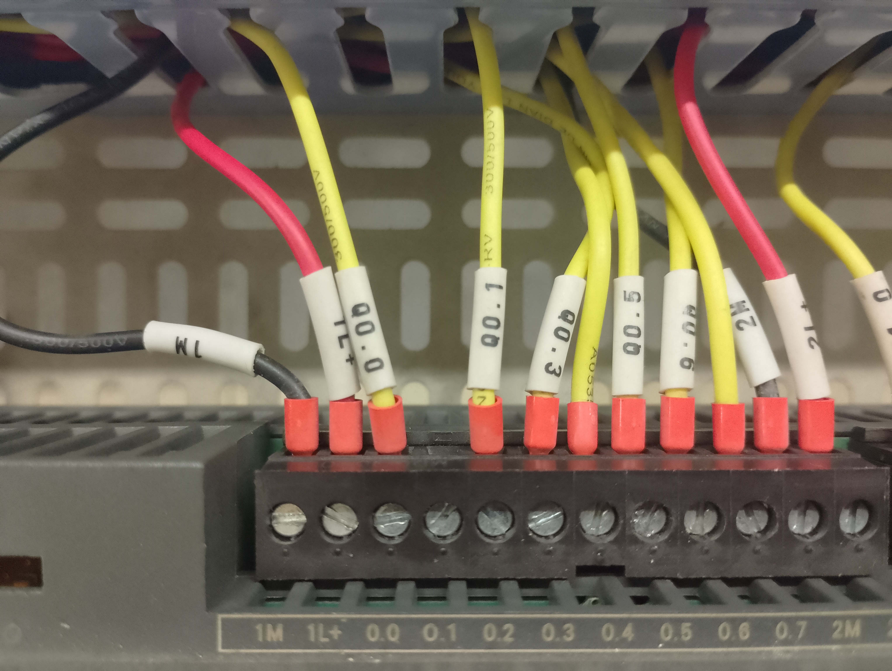

---

# 5. Ajuste Mecánico: Correa Dentada del Carro
*   **El Problema:** Desplazamientos erráticos y pérdida acumulada en las coordenadas de destino del servo en la Unidad de Transporte.
*   **El Aporte:** Se detectó que la correa intermedia de transmisión de par entre el motor y la correa principal de desplazamiento estaba montada al revés (los dientes miraban hacia afuera y la superficie lisa hacia los engranajes).
*   **Resultado:** Se desmontó la correa y se acopló correctamente con los dientes engranados hacia el interior, eliminando el deslizamiento por fricción.

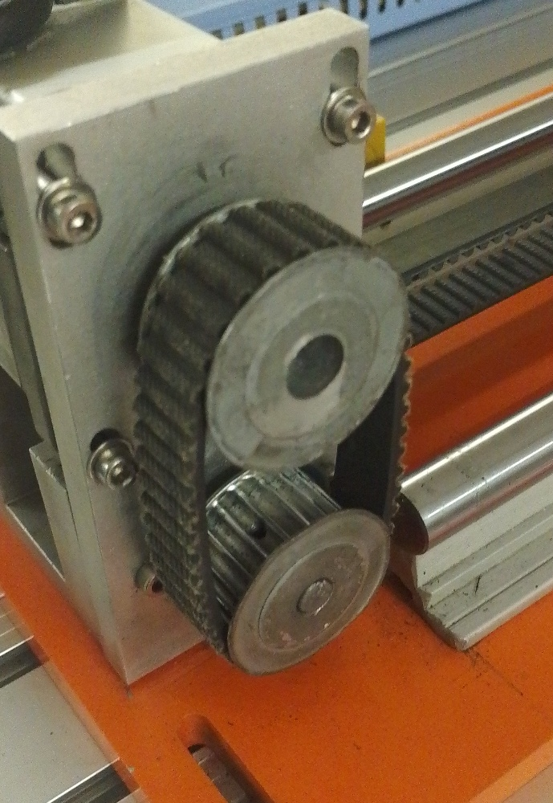

---

# 6. Reparación de Tornillo Prisionero en Engranaje
*   **El Problema:** El brazo lineal patinaba al intentar arrancar o frenar debido a holgura en los engranes de acoplamiento.
*   **El Aporte:** Inspección del sistema de engranajes donde se localizó un tornillo prisionero de cabeza esclava totalmente flojo y desgastado por fricción.
*   **Resultado:** Se retiró el juego mecánico y se ajustó firmemente con una llave allen, asegurando la transferencia de torque entre el eje del motor y la polea.

---

# Evidencia de Desgaste en Tornillo Prisionero
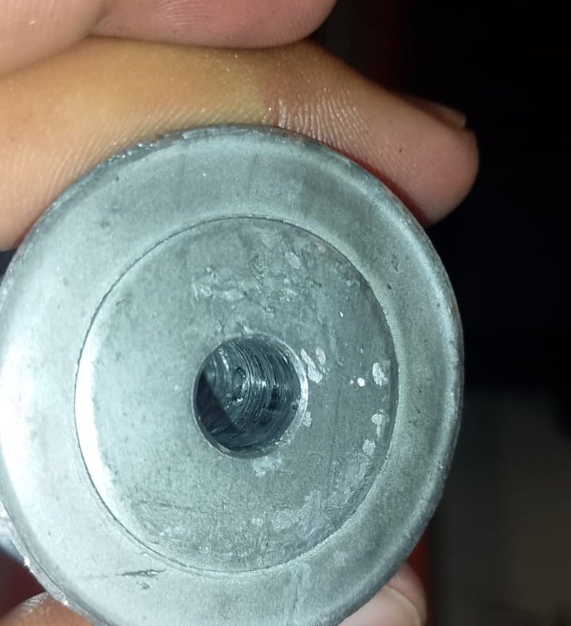

---

# Cabezal Allen del Tornillo en el Engrane
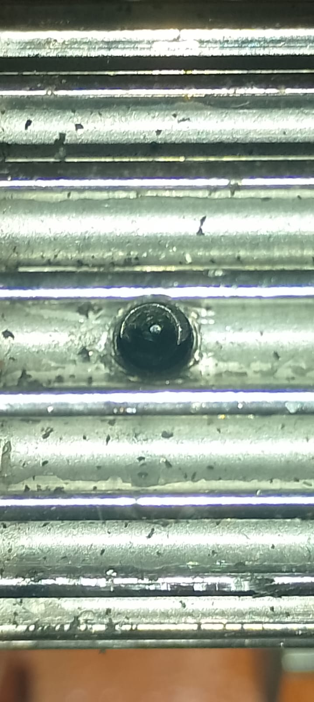

---

# 7. Reparación y Calibración de la Bomba de Aire
*   **El Problema:** La bomba de aire operaba de forma manual e insegura: el presostato estaba descalibrado, provocando que siguiera cargando presión hasta que la válvula de escape de emergencia se activaba (gran ruido y riesgo de explosión). Falta de mantenimiento del depósito.
*   **El Aporte:** Desarmado del cabezal de control, calibración de los resortes del tornillo de histéresis del presostato, y purga inferior del condensado (liberando gran cantidad de óxido de hierro acumulado).
*   **Resultado:** Ciclado automático seguro (arranque a 2.5 atm y apagado a 6 atm).

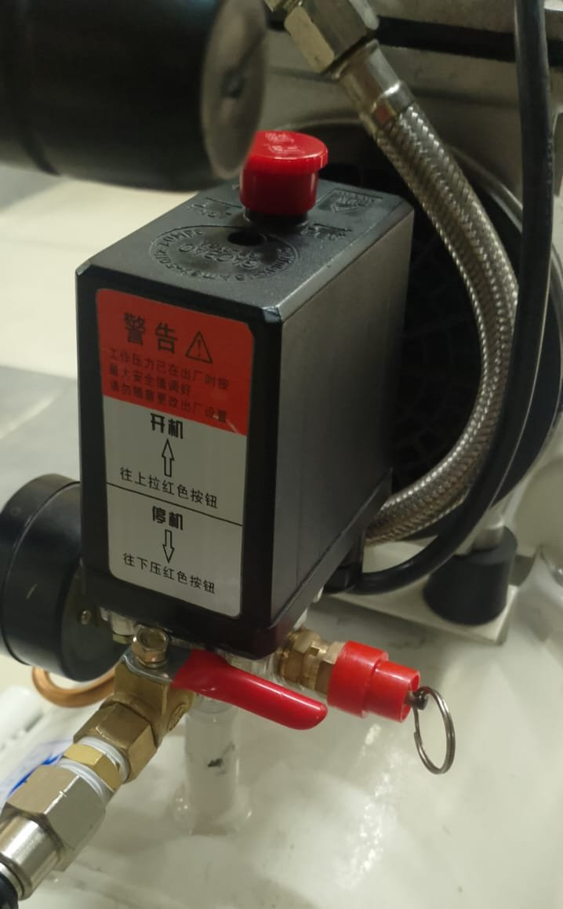

---

# 8. Soporte de Sensor en Unidad de Ensamblaje
*   **El Problema:** El sensor magnético de extensión del cilindro vertical (`I0.4`) de Ensamblaje (Estación 3) fallaba intermitentemente al no detectar el final de carrera, lo que detenía el brazo neumático a medio ciclo.
*   **La Causa:** La abrazadera de chapa de lata improvisada estaba floja y deformada, no logrando mantener el sensor pegado al cilindro.
*   **El Aporte:** Se realineó el sensor y se le aplicó una fijación posicional provisional en una orientación específica de alta sensibilidad.
*   **Resultado:** Señal estable de ciclo completado.

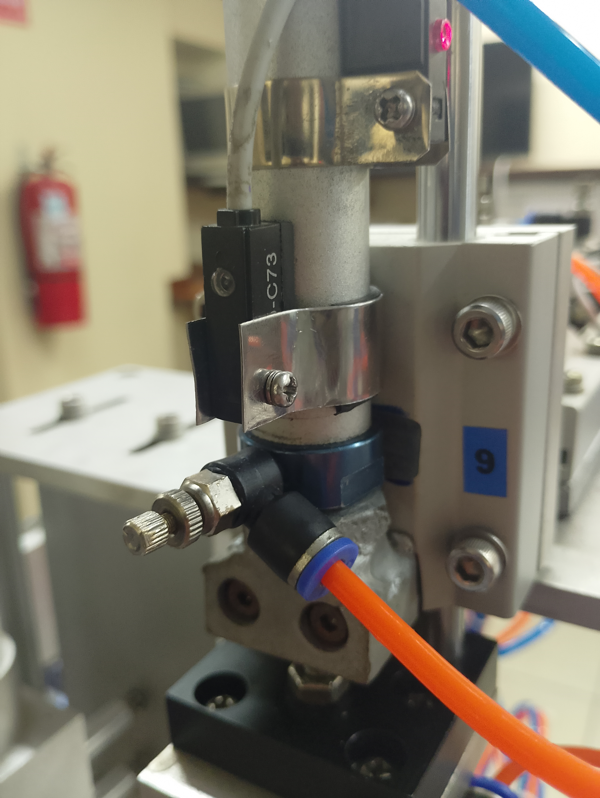

---

# 9. Alineación de Sensores de Alimentación
*   **El Problema:** Fallo constante de detección de piezas en la tolva de la Unidad de Alimentación (Estación 2), impidiendo que se inicie la dosificación inicial.
*   **El Aporte:** Se detectó que el soporte de los sensores fotoeléctricos alto y bajo estaba desalineado físicamente, provocando que el haz de luz pasara de largo sin interceptar el cuerpo de la pieza.
*   **Resultado:** Corrección y fijación de la posición del soporte metálico, logrando una tasa de lectura del 100%.

---

# Sensores de Tolva (Antes/Despues)

  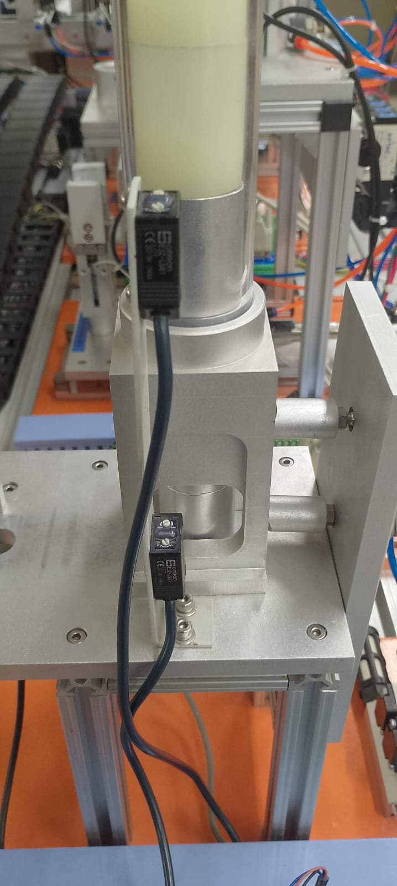
  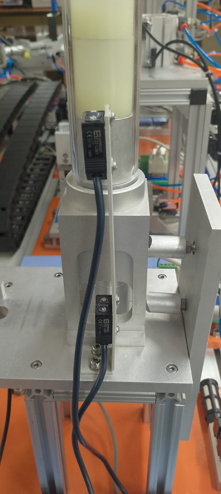

---

# Recomendaciones para Siguientes Semestres: 1/3
*   **Corrección Eléctrica en la Unidad de Selección (Sensores):**
    *   *El Problema Actual:* Los sensores de detección de presencia de Selección están cableados hacia el PLC de Transporte debido a la falta de entradas libres en el PLC local de Selección. 
    *   *Comportamiento Deficiente:* Al activarse un sensor, se induce una señal parásita (de ~5V) en las líneas contiguas que activa falsamente a los otros sensores. Se intentó unir las referencias de GND y VCC de ambas fuentes, pero el problema persiste.
    *   *Recomendación:* Se propone a los futuros grupos verificar la compatibilidad eléctrica de los transistores PNP de salida de los sensores fotoeléctricos con la impedancia de entrada del PLC o independizar por completo los canales de alimentación.

---

# Recomendaciones para Siguientes Semestres: 2/3
*   **Mejora de Deslizamiento de Piezas en Alimentación (Impresión 3D):**
    *   *El Desafío:* En la tolva de caída de Alimentación (Estación 2), las piezas de trabajo tienden a caer ligeramente ladeadas u orientadas fuera de eje, lo que traba el empujador neumático o desgasta el canal.
    *   *Recomendación:* Diseñar en software CAD (ej. SolidWorks) y fabricar mediante impresión 3D una guía o embudo cónico superior que obligue a las piezas a caer perfectamente horizontales en la base.

---

# Recomendaciones para Siguientes Semestres: 3/3
*   **Tope Mecánico en Pinzas de Procesamiento:**
    *   *El Desafío:* La apertura excesiva de la garra de sujeción neumática en la Unidad de Procesamiento (Estación 4) puede atascar la pieza en el momento de entrega por el carro lineal.
    *   *Recomendación:* Diseñar un tope físico que limite la carrera máxima del cilindro de las pinzas sin obstruir el cierre.
*   **Fuga en Colector Neumático de Ensamblaje:**
    *   *El Desafío:* Pérdida audible de presión por el escape/silenciador de una de las electroválvulas en la Estación 3.
    *   *Recomendación:* Realizar mantenimiento correctivo (cambio de o-rings/sellos) o reemplazo de la electroválvula.

---

# Propuesta de Proyecto para Semestres Posteriores
*   **Desafío del Proyecto:** Desarrollar un sistema SCADA y de diagnóstico de bajo nivel en **GNU/Linux (Linux Mint)** para la maqueta modular de 5 unidades, con la restricción de prohibir protocolos abiertos (como Modbus).
*   **Metodología:** Aplicar **ingeniería inversa al protocolo propietario PPI** usando **Python 3** y librerías especializadas como `Libnodave` o `python-snap7` para conectarse vía **USB-RS485** a los PLCs S7-200.
*   **Funcionalidades Requeridas:**
    *   Integración con una interfaz web en tiempo real.
    *   Lectura intrusiva directa de entradas (`I`) y forzado de salidas (`Q`).
    *   Manipulación remota del estado físico de las CPUs (`RUN`/`STOP`).
    *   Despliegue de métricas de clasificación de cilindros.
    *   *Autonomía del diseño:* Se delega en los alumnos el diseño de la arquitectura de la base de datos, la gestión de tiempos de silencio y la sincronización del bus para evitar colisiones.

---

# Justificación Técnica del SCADA PPI Directo
*   **Eliminación de la Bired (PPI/Modbus):** Se elimina la dependencia de mantener y sincronizar dos protocolos distintos (Modbus RTU y PPI), simplificando la topología de la red industrial a un único canal físico.
*   **Auditoría Externa Sin Modificación de Código:** El uso directo de PPI permite una mayor auditoría y control sobre las variables del PLC sin necesidad de agregar una sola línea de código en cada PLC individual.
*   *Comparativa con Modbus Único:* Aunque migrar toda la planta para comunicarse únicamente mediante Modbus es factible, resulta una alternativa mucho más tediosa debido a la necesidad de programar y mapear registros en cada PLC de manera individual.

