# Compendio de Redes de Petri
## Planta de Manufactura Flexible XK335B
### Modelado Formal CIPN — S7-200 CPU 224XP CN | Versión 4.0

---

> Este documento compila de forma integral los modelos **CIPN (Control Interpreted Petri Net)**
> desarrollados para la automatización coordinada de la planta modular flexible **XK335B**.
> Cada sección corresponde a una estación independiente. La **Estación 1 — Transporte** actúa
> como coordinador central del flujo de piezas entre el resto de estaciones.

---

## Índice

| # | Sección | Estación | Unidad |
|:---:|:---|:---|:---|
| 1 | [Red de Petri General — Coordinación Global](#1-red-de-petri-general--coordinación-global) | Sistema completo | Coordinación inter-PLC |
| 2 | [Estación 1 — Transporte](#2-estación-1--transporte) | Est. 1 | U1 — Coordinador central |
| 3 | [Estación 2 — Alimentación](#3-estación-2--alimentación) | Est. 2 | U2 — Dosificador de piezas |
| 4 | [Estación 3 — Ensamblaje](#4-estación-3--ensamblaje) | Est. 3 | U3 — Pick & place + dosificador de tapas |
| 5 | [Estación 4 — Procesamiento](#5-estación-4--procesamiento) | Est. 4 | U4 — Prensado neumático |
| 6 | [Estación 5 — Selección](#6-estación-5--selección) | Est. 5 | U5 — Clasificación y eyección |

---

## Leyenda Global

| Elemento | Representación | Significado |
|:---|:---|:---|
| Plaza de control | Óvalo borde **verde** | Estado de reposo o coordinación |
| Plaza de ejecución | Óvalo borde **naranja** | Estado de acción en curso |
| Plaza de solicitud | Óvalo borde **azul** | Solicitud de tarea pendiente |
| Plaza pick | Óvalo borde **rojo-naranja** | Paso de secuencia de recogida |
| Plaza place | Óvalo borde **azul intenso** | Paso de secuencia de depósito |
| Plaza homing | Óvalo borde **morado** | Estado de búsqueda de origen servo |
| Transición normal | Rectángulo gris oscuro | Evento de cambio de estado |
| Transición Prioridad 1 | Rectángulo borde **rojo** | Mayor prioridad de atención |
| Transición Prioridad 2 | Rectángulo borde **amarillo** | Prioridad media |
| Transición Prioridad 3 | Rectángulo borde **verde** | Menor prioridad |
| Nodo INIT | Óvalo gris punteado | Primer scan del PLC (SM0.1) |
| Nodo EMERG | Óvalo rojo oscuro | Condición de emergencia (seta activa) |
| Flecha `-->` | Sólida | Flujo de marcas / tokens |
| Flecha `-.->` | Punteada | Emergencia o condición de disparo |

---

## 1. Red de Petri General — Coordinación Global

---

## Leyenda
- **Círculos / Óvalos** = Plazas (estados estables, portadoras de marcas M)
- **Rectángulos** = Transiciones (eventos que cambian el estado)
- **Flechas sólidas** = Flujo de marcas interno a cada estación
- **Flechas etiquetadas** = Señales de sincronización inter-PLC (handshake vía red PPI/Modbus)
- La **Unidad de Transporte (U4)** actúa como coordinador central del flujo de piezas

---

## Diagrama de Coordinación Global

```mermaid
flowchart TD

    %% =========================================================
    %% UNIDAD DE ALIMENTACIÓN — Estación 2
    %% =========================================================

    subgraph U1["Estación 2 — Alimentación"]
        U1_P0(["U1: Reposo\n[M0.0]\nEspera pieza en base"]):::plaza_ctrl
        U1_P1(["U1: Proceso\n[M0.1..M0.4]\nCiclo de dosificación activo"]):::plaza_exec
        U1_P2(["U1: Espera Recogida\n[Req A-P]\nPieza disponible en salida"]):::plaza_req

        U1_T0["T: Iniciar Dosificación\nM2.0 AND M2.1\n(Marcha + Pieza en base)"]:::trans
        U1_T1["T: Pieza Disponible\nM2.5 (Cil_Peq_Ret)\n(Ciclo completo)"]:::trans
        U1_T_Hand["T: Brazo Recoge U1\n(Señal del Coordinador)"]:::trans

        U1_P0 --> U1_T0
        U1_T0 -->|"S M0.1"| U1_P1
        U1_P1 --> U1_T1
        U1_T1 -->|"S Req_AP\nS M0.0"| U1_P2
        U1_P2 --> U1_T_Hand
        U1_T_Hand -->|"R Req_AP"| U1_P0
    end

    %% =========================================================
    %% UNIDAD DE PROCESAMIENTO — Estación 4
    %% =========================================================

    subgraph U2["Estación 4 — Procesamiento"]
        U2_P0(["U2: Vacío\n[M0.0]\nListo para recibir pieza"]):::plaza_ctrl
        U2_P1(["U2: Proceso\n[M0.1..M0.5]\nCiclo de prensado activo"]):::plaza_exec
        U2_P2(["U2: Espera Recogida\n[Req P-E]\nPieza procesada disponible"]):::plaza_req

        U2_T_In["T: Brazo Deposita U2\n(Señal del Coordinador)"]:::trans
        U2_T1["T: Proceso OK\nM1.5 (Carro en origen)\n(Ciclo completo)"]:::trans
        U2_T_Out["T: Brazo Recoge U2\n(Señal del Coordinador)"]:::trans

        U2_P0 --> U2_T_In
        U2_T_In -->|"S M0.1"| U2_P1
        U2_P1 --> U2_T1
        U2_T1 -->|"S Req_PE\nS M0.0"| U2_P2
        U2_P2 --> U2_T_Out
        U2_T_Out -->|"R Req_PE"| U2_P0
    end

    %% =========================================================
    %% UNIDAD DE ENSAMBLAJE — Estación 3
    %% =========================================================

    subgraph U3["Estación 3 — Ensamblaje"]
        U3_P0(["U3: Vacío\n[M0.0]\nListo para recibir pieza"]):::plaza_ctrl
        U3_P1(["U3: Proceso\n[M0.1..M1.4]\nCiclo de ensamblaje activo"]):::plaza_exec
        U3_P2(["U3: Espera Recogida\n[Req E-S]\nPieza ensamblada disponible"]):::plaza_req

        U3_T_In["T: Brazo Deposita U3\n(Señal del Coordinador)"]:::trans
        U3_T1["T: Ensamblaje OK\nM5.4 (Reset_Arm)\n(Ciclo completo)"]:::trans
        U3_T_Out["T: Brazo Recoge U3\n(Señal del Coordinador)"]:::trans

        U3_P0 --> U3_T_In
        U3_T_In -->|"S M0.1"| U3_P1
        U3_P1 --> U3_T1
        U3_T1 -->|"S Req_ES\nS M0.0"| U3_P2
        U3_P2 --> U3_T_Out
        U3_T_Out -->|"R Req_ES"| U3_P0
    end

    %% =========================================================
    %% UNIDAD DE SELECCIÓN — Estación 5
    %% =========================================================

    subgraph U5["Estación 5 — Selección"]
        U5_P0(["U5: Vacío\n[M0.0]\nListo para recibir pieza"]):::plaza_ctrl
        U5_P1(["U5: Clasificación\n[M0.1..M0.5]\nCiclo de selección activo"]):::plaza_exec

        U5_T_In["T: Brazo Deposita U5\n(Señal del Coordinador)"]:::trans
        U5_T1["T: Clasificación OK\nM1.5 (Fin Ciclo)\n(Ciclo completo)"]:::trans

        U5_P0 --> U5_T_In
        U5_T_In -->|"S M0.1"| U5_P1
        U5_P1 --> U5_T1
        U5_T1 -->|"S M0.0"| U5_P0
    end

    %% =========================================================
    %% COORDINADOR DE TRANSPORTE — Estación 1 (eje central)
    %% =========================================================

    subgraph U4["Estación 1 — Transporte (Coordinador)"]
        U4_P0(["Brazo Libre\n[M0.0]\nReposo, listo para tarea"]):::plaza_ctrl

        U4_T_AP["T: Atender A-P\n[M4.4] PRIORIDAD 3\nM0.0 AND Req_AP AND U2_Vacio"]:::trans_prio3
        U4_T_PE["T: Atender P-E\n[M4.3] PRIORIDAD 2\nM0.0 AND Req_PE AND U3_Vacio AND !Req_ES"]:::trans_prio2
        U4_T_ES["T: Atender E-S\n[M4.2] PRIORIDAD 1\nM0.0 AND Req_ES AND U5_Vacio"]:::trans_prio1

        U4_P_Exec(["Ejecutando Tarea\n[M1.0..M3.6]\nPick + Viaje + Place en curso"]):::plaza_exec

        U4_T_Done["T: Tarea Finalizada\n[M6.7]\nM3.6 (Secuencia Place completa)"]:::trans

        U4_P0 --> U4_T_AP
        U4_P0 --> U4_T_PE
        U4_P0 --> U4_T_ES
        U4_T_AP -->|"S M1.0\nS M7.0"| U4_P_Exec
        U4_T_PE -->|"S M1.0\nS M7.1"| U4_P_Exec
        U4_T_ES -->|"S M1.0\nS M7.2"| U4_P_Exec
        U4_P_Exec --> U4_T_Done
        U4_T_Done -->|"S M0.0\nR M7.x\nR Solicitud"| U4_P0
    end

    %% =========================================================
    %% SINCRONIZACIÓN (Handshakes inter-PLC)
    %% =========================================================

    U1_P2 -->|"Req A-P\n(red PPI/Modbus)"| U4_T_AP
    U2_P0 -->|"U2 Vacío\n(red PPI/Modbus)"| U4_T_AP
    U4_T_AP -->|"Drop U2\n(confirmación)"| U2_T_In

    U2_P2 -->|"Req P-E\n(red PPI/Modbus)"| U4_T_PE
    U3_P0 -->|"U3 Vacío\n(red PPI/Modbus)"| U4_T_PE
    U4_T_PE -->|"Drop U3\n(confirmación)"| U3_T_In

    U3_P2 -->|"Req E-S\n(red PPI/Modbus)"| U4_T_ES
    U5_P0 -->|"U5 Vacío\n(red PPI/Modbus)"| U4_T_ES
    U4_T_ES -->|"Drop U5\n(confirmación)"| U5_T_In

    %% =========================================================
    %% ESTILOS
    %% =========================================================

    classDef plaza_ctrl   fill:#1f2e24,stroke:#16a34a,stroke-width:3px,color:#c9d1d9
    classDef plaza_req    fill:#1f282e,stroke:#0284c7,stroke-width:2px,color:#c9d1d9
    classDef plaza_exec   fill:#2e2c1f,stroke:#ca8a04,stroke-width:2px,color:#c9d1d9
    classDef trans        fill:#161b22,stroke:#475569,stroke-width:1px,color:#c9d1d9
    classDef trans_prio1  fill:#4a1010,stroke:#f87171,stroke-width:2px,color:#c9d1d9
    classDef trans_prio2  fill:#4a2c10,stroke:#fcd34d,stroke-width:2px,color:#c9d1d9
    classDef trans_prio3  fill:#103a1a,stroke:#86efac,stroke-width:2px,color:#c9d1d9
```

---

## Protocolo de Coordinación (Handshake inter-PLC)

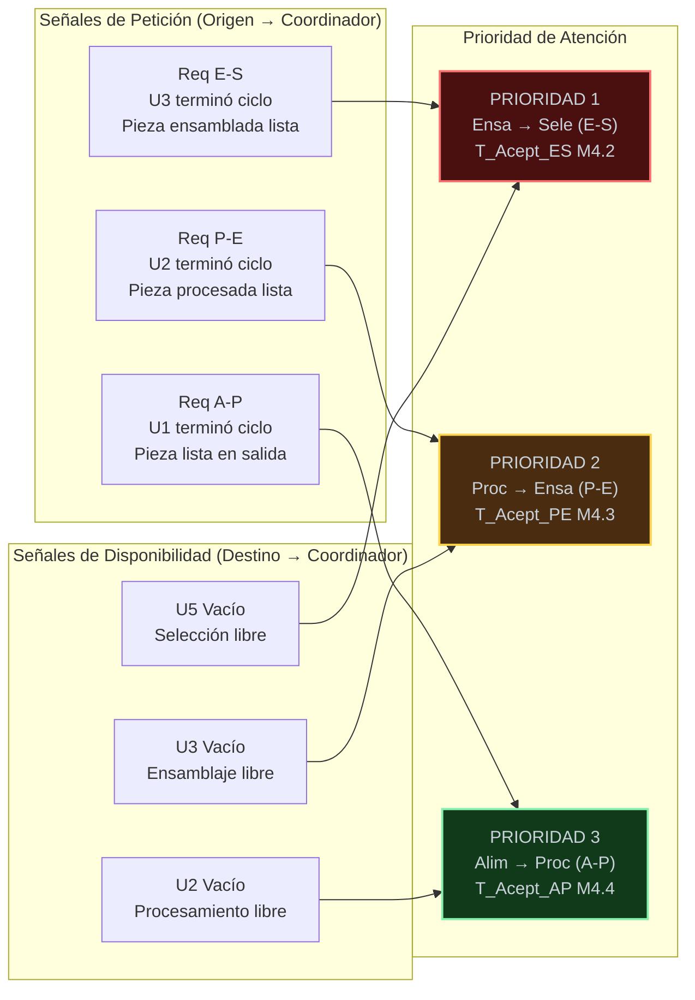

---

## Tabla de Estaciones (referencia rápida)

| Estación | Unidad | Rol | Plaza de Reposo | Plaza de Espera | Señal de Solicitud |
|:---|:---|:---|:---|:---|:---|
| Est. 1 | U4 — Transporte | Coordinador central | M0.0 Brazo Libre | — | — |
| Est. 2 | U1 — Alimentación | Origen del flujo | M0.0 Reposo | Req A-P | Pieza disponible → U4 |
| Est. 4 | U2 — Procesamiento | Estación intermedia 1 | M0.0 Vacío | Req P-E | Pieza procesada → U4 |
| Est. 3 | U3 — Ensamblaje | Estación intermedia 2 | M0.0 Vacío | Req E-S | Pieza ensamblada → U4 |
| Est. 5 | U5 — Selección | Destino final | M0.0 Vacío | — | Fin de proceso |

---

## Reglas de Coordinación

El Coordinador de Transporte (U4) solo dispara un traslado si se cumplen **simultáneamente** las tres condiciones siguientes:

| Condición | Verificación |
|:---|:---|
| **Brazo libre** | M0.0 activo en U4 (Brazo Libre) |
| **Origen con pieza** | Plaza de "Espera Recogida" activa en la estación origen |
| **Destino vacío** | Plaza "Vacío" activa en la estación destino |

En caso de múltiples solicitudes simultáneas, el sistema resuelve el conflicto por **prioridad fija descendente**: E-S > P-E > A-P. Esto garantiza que la línea no se bloquee por acumulación en las estaciones de mayor valor añadido.

---

## 2. Estación 1 — Transporte

---

## Leyenda
- **Círculos / Óvalos** = Plazas (estados estables, portadoras de marcas M)
- **Rectángulos** = Transiciones (eventos que cambian el estado)
- **Flechas sólidas** = Flujo de marcas
- **Flechas punteadas** = Condiciones de disparo (sensores/flags) o emergencia
- `[Mx.y]` = Marca de memoria interna asociada a la plaza o transición

---

## Diagrama Principal

```mermaid
flowchart TD

    %% =========================================================
    %% ARRANQUE
    %% =========================================================

    INIT(["SM0.1\nPrimer Scan"]):::init

    %% =========================================================
    %% ZONA 0: HOMING
    %% =========================================================

    P_Hom_Esp(["P_Hom_Espera\n[M5.0]\nEstado inicial / post-emergencia"]):::plaza_hom
    P_Hom_Act(["P_Hom_Activo\n[M5.1]\nServo buscando origen"]):::plaza_hom

    T_Hom_Ini["T_Homing_Start\n[M4.0]\nM5.0 AND M6.0 AND M3.4\n(Hom_Esp + Marcha + Servo OK)"]:::trans
    T_Hom_Done["T_Homing_Done\n[M4.1]\nM5.1 AND M3.3\n(Hom_Act + Sensor I0.0)"]:::trans

    INIT -->|"S M5.0"| P_Hom_Esp
    P_Hom_Esp --> T_Hom_Ini
    T_Hom_Ini --> P_Hom_Act
    P_Hom_Act --> T_Hom_Done

    %% =========================================================
    %% ZONA 1: REPOSO Y SOLICITUDES
    %% =========================================================

    P0(["P0 Brazo Libre\n[M0.0]\nReposo - listo para tarea"]):::plaza_ctrl
    P1(["P1 Req A-P\n[M0.1]\nSolicitud Alim -> Proc"]):::plaza_req
    P2(["P2 Req P-E\n[M0.2]\nSolicitud Proc -> Ensa"]):::plaza_req
    P3(["P3 Req E-S\n[M0.3]\nSolicitud Ensa -> Sele"]):::plaza_req

    T_Hom_Done -->|"S M0.0"| P0

    P0 -.->|"Standalone:\nM0.0 AND I2.7\nAND !M0.1..M0.3"| P1
    P0 -.->|"Modbus / HMI"| P2
    P0 -.->|"Modbus / HMI"| P3

    %% =========================================================
    %% ZONA 2: ACEPTACIÓN DE TAREA (priorizadas)
    %% =========================================================

    T_ES["T_Acept_ES\n[M4.2]\nPRIORIDAD 1\nM0.0 AND M0.3 AND !M6.1"]:::trans_prio1
    T_PE["T_Acept_PE\n[M4.3]\nPRIORIDAD 2\nM0.0 AND M0.2 AND !M0.3 AND !M6.1"]:::trans_prio2
    T_AP["T_Acept_AP\n[M4.4]\nPRIORIDAD 3\nM0.0 AND M0.1 AND !M0.2 AND !M0.3 AND !M6.1"]:::trans_prio3

    P0 --> T_ES
    P0 --> T_PE
    P0 --> T_AP
    P3 --> T_ES
    P2 --> T_PE
    P1 --> T_AP

    %% =========================================================
    %% ZONA 3: VIAJE AL ORIGEN
    %% =========================================================

    P10(["P10 Viaje Origen\n[M1.0]\nServo -> coord recogida\nVD200 = coord estación origen"]):::plaza_exec

    T_ES -->|"S M1.0\nS M7.2\nVD200 <- VD212 (92000p)"| P10
    T_PE -->|"S M1.0\nS M7.1\nVD200 <- VD208 (50000p)"| P10
    T_AP -->|"S M1.0\nS M7.0\nVD200 <- VD204 (8000p)"| P10

    T_Ori_OK["T_Origen_OK\n[M4.5]\nM1.0 AND M3.2\n(Viaje_Ori + Done MAP_SERV)"]:::trans
    P10 --> T_Ori_OK

    %% =========================================================
    %% ZONA 4: SECUENCIA PICK (6 pasos)
    %% =========================================================

    P11a(["P11a Rot Origen\n[M1.1]\nOrientar garra\nQ0.5 activo (H)"]):::plaza_pick
    P11b(["P11b DV Extender\n[M1.2]\nExtender doble vástago\nQ0.6 activo"]):::plaza_pick
    P11c(["P11c Bajar Brazo\n[M1.3]\nCilindro vertical baja\nQ0.3 inactivo"]):::plaza_pick
    P11d(["P11d Cerrar Pinza\n[M1.4]\nCerrar pinza\nQ1.0 activo"]):::plaza_pick
    P11e(["P11e Subir Brazo\n[M1.5]\nCilindro vertical sube\nQ0.3 activo"]):::plaza_pick
    P11f(["P11f DV Retraer\n[M1.6]\nRetraer doble vástago\nQ0.6 inactivo"]):::plaza_pick

    T_Rot_Ori["T_Rot_Ori_OK\n[M4.6]\nM1.1 AND M2.6\n(Rot_Ori + Giro H I0.6)"]:::trans
    T_DV_Ext_P["T_DV_Ext_Pick\n[M4.7]\nM1.2 AND M2.7\n(DV_Ext + Sensor I0.7)"]:::trans
    T_Cil_Baj_P["T_CilV_Baj_Pick\n[M5.2]\nM1.3 AND M2.3\n(Cil_Baj + Sensor I0.3)"]:::trans
    T_Pinza_C["T_Pinza_Cer\n[M5.3]\nM1.4 AND M3.1\n(Pinza_Cer + Sensor I1.1)"]:::trans
    T_Cil_Arr_P["T_CilV_Arr_Pick\n[M5.4]\nM1.5 AND M2.4\n(Cil_Arr + Sensor I0.4)"]:::trans
    T_DV_Ret_P["T_DV_Ret_Pick\n[M5.5]\nM1.6 AND M3.0\n(DV_Ret + Sensor I1.0)"]:::trans

    T_Ori_OK --> P11a
    P11a --> T_Rot_Ori
    T_Rot_Ori --> P11b
    P11b --> T_DV_Ext_P
    T_DV_Ext_P --> P11c
    P11c --> T_Cil_Baj_P
    T_Cil_Baj_P --> P11d
    P11d --> T_Pinza_C
    T_Pinza_C --> P11e
    P11e --> T_Cil_Arr_P
    T_Cil_Arr_P --> P11f
    P11f --> T_DV_Ret_P

    %% =========================================================
    %% ZONA 5: ORIENTACIÓN DESTINO + VIAJE AL DESTINO
    %% =========================================================

    P13a(["P13a Rot Destino\n[M2.0]\nOrientar garra según contexto\nQ0.5 (H) o Q0.4 (AH)"]):::plaza_place

    T_Rot_Des["T_Rot_Des_OK\n[M5.7]\nM2.0 AND\n((M2.6 AND !M7.2) OR (M2.5 AND M7.2))\nH para A-P/P-E, AH para E-S"]:::trans

    T_DV_Ret_P -->|"S M2.0"| P13a
    P13a --> T_Rot_Des

    P12(["P12 Viaje Destino\n[M1.7]\nServo -> coord entrega\nVD200 = coord estación destino"]):::plaza_exec
    T_Des_OK["T_Destino_OK\n[M5.6]\nM1.7 AND M3.2\n(Viaje_Des + Done MAP_SERV)"]:::trans

    T_Rot_Des -->|"S M1.7\nVD200 <- coord según M7.x\nM7.0: VD208\nM7.1: VD212\nM7.2: VD216"| P12
    P12 --> T_Des_OK

    %% =========================================================
    %% ZONA 6: SECUENCIA PLACE (5 pasos)
    %% =========================================================

    P13b(["P13b DV Extender\n[M2.1]\nExtender doble vástago\nQ0.6 activo"]):::plaza_place
    P13c(["P13c Bajar Brazo\n[M2.2]\nCilindro vertical baja\nQ0.3 inactivo"]):::plaza_place
    P13d(["P13d Abrir Pinza\n[M8.0]\nAbrir pinza\nQ0.7 activo"]):::plaza_place
    P13e(["P13e Subir Brazo\n[M8.1]\nCilindro vertical sube\nQ0.3 activo"]):::plaza_place
    P13f(["P13f DV Retraer\n[M3.5]\nRetraer doble vástago\nQ0.6 inactivo"]):::plaza_place

    T_DV_Ext_L["T_DV_Ext_Place\n[M6.2]\nM2.1 AND M2.7\n(DV_Ext + Sensor I0.7)"]:::trans
    T_Cil_Baj_L["T_CilV_Baj_Place\n[M6.3]\nM2.2 AND M2.3\n(Cil_Baj + Sensor I0.3)"]:::trans
    T_Pinza_A["T_Pinza_Ab\n[M6.4]\nM8.0 AND !M3.1\n(Pinza_Ab + !Sensor I1.1)"]:::trans
    T_Cil_Arr_L["T_CilV_Arr_Place\n[M6.5]\nM8.1 AND M2.4\n(Cil_Arr + Sensor I0.4)"]:::trans
    T_DV_Ret_L["T_DV_Ret_Place\n[M6.6]\nM3.5 AND M3.0\n(DV_Ret + Sensor I1.0)"]:::trans

    T_Des_OK --> P13b
    P13b --> T_DV_Ext_L
    T_DV_Ext_L --> P13c
    P13c --> T_Cil_Baj_L
    T_Cil_Baj_L --> P13d
    P13d --> T_Pinza_A
    T_Pinza_A --> P13e
    P13e --> T_Cil_Arr_L
    T_Cil_Arr_L --> P13f
    P13f --> T_DV_Ret_L

    %% =========================================================
    %% ZONA 7: FINALIZACIÓN
    %% =========================================================

    P14(["P14 Finalizar\n[M3.6]\nLimpiar solicitud y contexto\nLiberar brazo (S M0.0)"]):::plaza_exec
    T_Fin["T_Tarea_Fin\n[M6.7]\nM3.6\n(sin condición adicional)"]:::trans

    T_DV_Ret_L --> P14
    P14 --> T_Fin
    T_Fin -->|"S M0.0\nR M0.x solicitud\nR M7.0..3 contexto"| P0

    %% =========================================================
    %% EMERGENCIA
    %% =========================================================

    EMERG(["EMERGENCIA\nI2.6 = 0\nSeta activa"]):::emerg

    EMERG -.->|"R M0.1..M0.3\nR M1.0..M1.6\nR M2.0..M2.2\nR M8.0 M8.1\nR M3.5 M3.6\nR Q0.3..Q1.0\nS M5.0"| P_Hom_Esp

    %% =========================================================
    %% ESTILOS
    %% =========================================================

    classDef plaza_hom    fill:#2e1f2f,stroke:#a855f7,stroke-width:2px,color:#c9d1d9
    classDef plaza_ctrl   fill:#1f2e24,stroke:#16a34a,stroke-width:3px,color:#c9d1d9
    classDef plaza_req    fill:#1f282e,stroke:#0284c7,stroke-width:2px,color:#c9d1d9
    classDef plaza_exec   fill:#2e2c1f,stroke:#ca8a04,stroke-width:2px,color:#c9d1d9
    classDef plaza_pick   fill:#2e251f,stroke:#ea580c,stroke-width:2px,color:#c9d1d9
    classDef plaza_place  fill:#1f242e,stroke:#2563eb,stroke-width:2px,color:#c9d1d9
    classDef trans        fill:#161b22,stroke:#475569,stroke-width:1px,color:#c9d1d9
    classDef trans_prio1  fill:#4a1010,stroke:#f87171,stroke-width:2px,color:#c9d1d9
    classDef trans_prio2  fill:#4a2c10,stroke:#fcd34d,stroke-width:2px,color:#c9d1d9
    classDef trans_prio3  fill:#103a1a,stroke:#86efac,stroke-width:2px,color:#c9d1d9
    classDef init         fill:#1e293b,stroke:#64748b,stroke-width:1px,color:#c9d1d9,stroke-dasharray:4
    classDef emerg        fill:#450a0a,stroke:#f87171,stroke-width:3px,color:#c9d1d9
```

---

## Mapa de Contexto de Tarea

Cuando se acepta una solicitud, el sistema guarda el contexto activo en **M7.0 / M7.1 / M7.2**. Estas marcas determinan las coordenadas y la orientación de la garra.

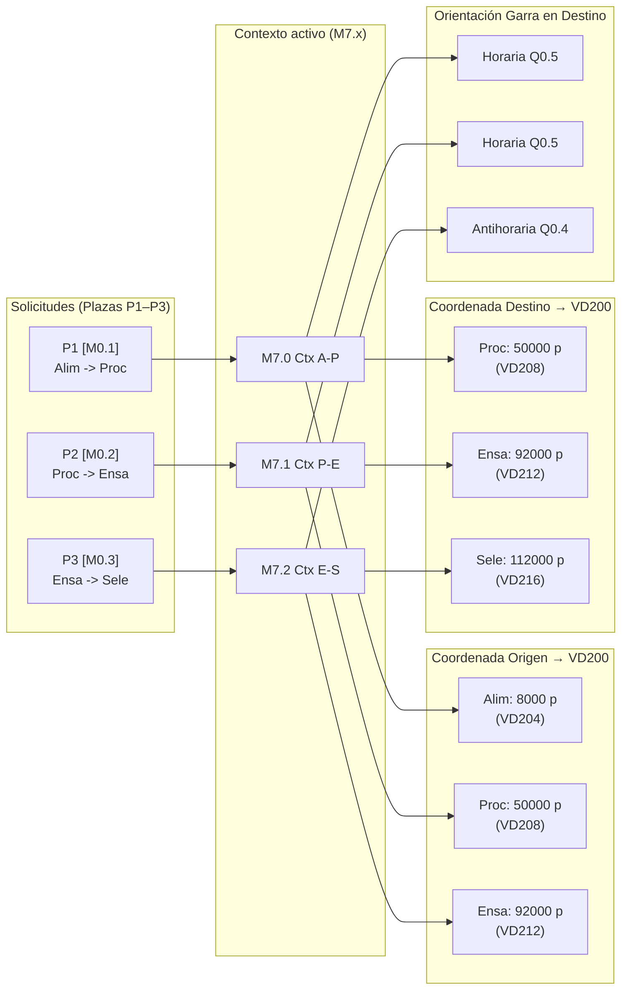

---

## Tabla de Plazas (referencia rápida)

| Plaza | Marca | Zona | Descripción | Salidas Q activas |
|:---|:---|:---|:---|:---|
| P_Hom_Espera | M5.0 | Homing | Arranque / post-emergencia | Q0.3 (brazo arriba) |
| P_Hom_Activo | M5.1 | Homing | Servo buscando origen | Q0.3 (brazo arriba) |
| **P0 Brazo Libre** | **M0.0** | **Ctrl** | **Reposo, listo** | Q1.7 (roja) |
| P1 Req A-P | M0.1 | Solicitudes | Solicitud pendiente A→P | — |
| P2 Req P-E | M0.2 | Solicitudes | Solicitud pendiente P→E | — |
| P3 Req E-S | M0.3 | Solicitudes | Solicitud pendiente E→S | — |
| P10 Viaje Origen | M1.0 | Ejecución | Servo en movimiento a recogida | Q0.3, Q1.6 |
| P11a Rot Origen | M1.1 | Pick | Orientar garra (horaria) | Q0.3, Q0.5, Q0.7, Q1.6 |
| P11b DV Extender | M1.2 | Pick | Extender doble vástago | Q0.3, Q0.5, Q0.6, Q0.7, Q1.6 |
| P11c Bajar Brazo | M1.3 | Pick | Bajar brazo (Q0.3 inactivo) | Q0.5, Q0.6, Q0.7, Q1.6 |
| P11d Cerrar Pinza | M1.4 | Pick | Cerrar pinza | Q0.6, Q1.0, Q1.6 |
| P11e Subir Brazo | M1.5 | Pick | Subir con pieza | Q0.3, Q0.6, Q1.0, Q1.6 |
| P11f DV Retraer | M1.6 | Pick | Retraer doble vástago | Q0.3, Q1.0, Q1.6 |
| P13a Rot Destino | M2.0 | Orientación | Orientar según contexto | Q0.3, Q0.4 o Q0.5, Q1.0, Q1.6 |
| P12 Viaje Destino | M1.7 | Ejecución | Servo en movimiento a entrega | Q0.3, Q1.0, Q1.6 |
| P13b DV Extender | M2.1 | Place | Extender doble vástago | Q0.3, Q0.5, Q0.6, Q1.0, Q1.6 |
| P13c Bajar Brazo | M2.2 | Place | Bajar brazo (Q0.3 inactivo) | Q0.5, Q0.6, Q1.0, Q1.6 |
| P13d Abrir Pinza | M8.0 | Place | Abrir pinza | Q0.6, Q0.7, Q1.6 |
| P13e Subir Brazo | M8.1 | Place | Subir tras soltar | Q0.3, Q0.7, Q1.6 |
| P13f DV Retraer | M3.5 | Place | Retraer doble vástago | Q0.3, Q0.7, Q1.6 |
| P14 Finalizar | M3.6 | Ejecución | Limpiar y liberar brazo | Q0.3, Q1.6 |

---

## Tabla de Transiciones (referencia rápida)

| Transición | Marca | Condición (AWL) | Acción principal |
|:---|:---|:---|:---|
| T_Homing_Start | M4.0 | M5.0 AND M6.0 AND M3.4 | R M5.0, S M5.1 |
| T_Homing_Done | M4.1 | M5.1 AND M3.3 | R M5.1, S M0.0 |
| T_Acept_ES | M4.2 | M0.0 AND M0.3 AND !M6.1 | R M0.0, S M1.0, S M7.2, VD200←VD212 |
| T_Acept_PE | M4.3 | M0.0 AND M0.2 AND !M0.3 AND !M6.1 | R M0.0, S M1.0, S M7.1, VD200←VD208 |
| T_Acept_AP | M4.4 | M0.0 AND M0.1 AND !M0.2 AND !M0.3 AND !M6.1 | R M0.0, S M1.0, S M7.0, VD200←VD204 |
| T_Origen_OK | M4.5 | M1.0 AND M3.2 | R M1.0, S M1.1 |
| T_Rot_Ori_OK | M4.6 | M1.1 AND M2.6 | R M1.1, S M1.2 |
| T_DV_Ext_Pick | M4.7 | M1.2 AND M2.7 | R M1.2, S M1.3 |
| T_CilV_Baj_Pick | M5.2 | M1.3 AND M2.3 | R M1.3, S M1.4 |
| T_Pinza_Cer | M5.3 | M1.4 AND M3.1 | R M1.4, S M1.5 |
| T_CilV_Arr_Pick | M5.4 | M1.5 AND M2.4 | R M1.5, S M1.6 |
| T_DV_Ret_Pick | M5.5 | M1.6 AND M3.0 | R M1.6, S M2.0 |
| T_Rot_Des_OK | M5.7 | M2.0 AND (Giro H si !M7.2, Giro AH si M7.2) | R M2.0, S M1.7, VD200←coord destino |
| T_Destino_OK | M5.6 | M1.7 AND M3.2 | R M1.7, S M2.1 |
| T_DV_Ext_Place | M6.2 | M2.1 AND M2.7 | R M2.1, S M2.2 |
| T_CilV_Baj_Place | M6.3 | M2.2 AND M2.3 | R M2.2, S M8.0 |
| T_Pinza_Ab | M6.4 | M8.0 AND !M3.1 | R M8.0, S M8.1 |
| T_CilV_Arr_Place | M6.5 | M8.1 AND M2.4 | R M8.1, S M3.5 |
| T_DV_Ret_Place | M6.6 | M3.5 AND M3.0 | R M3.5, S M3.6 |
| T_Tarea_Fin | M6.7 | M3.6 | R M3.6, S M0.0, R M7.0..3, R M0.x solicitud |

---

## 3. Estación 2 — Alimentación

---

## Leyenda
- **Círculos / Óvalos** = Plazas (estados estables, portadoras de marcas M)
- **Rectángulos** = Transiciones (eventos que cambian el estado)
- **Flechas sólidas** = Flujo de marcas
- **Flechas punteadas** = Condición de emergencia
- `[Mx.y]` = Marca de memoria interna asociada

---

## Diagrama Principal

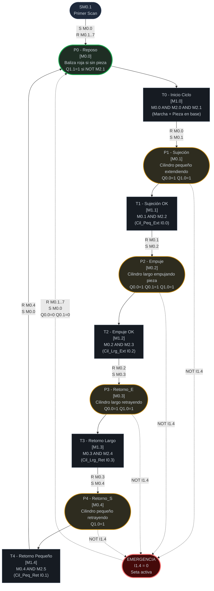

---

## Mapa de Eventos (Entradas Físicas → Marcas Internas)

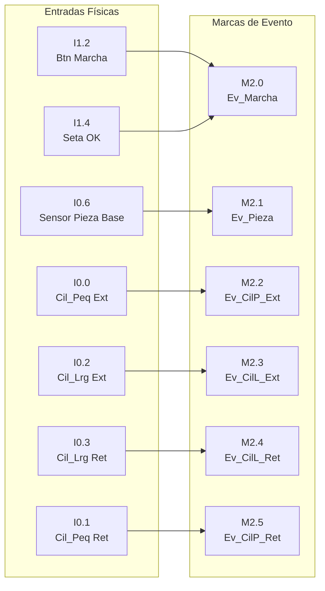

---

## Tabla de Plazas (referencia rápida)

| Plaza | Marca | Nombre | Descripción | Salidas Q activas |
|:---|:---|:---|:---|:---|
| **P0** | **M0.0** | **Reposo** | **Estado inicial / post-emergencia** | **Q1.1 si NOT M2.1** |
| P1 | M0.1 | Sujeción | Cilindro pequeño extendiendo (sujeta columna) | Q0.0, Q1.0 |
| P2 | M0.2 | Empuje | Cilindro largo empuja pieza hacia salida | Q0.0, Q0.1, Q1.0 |
| P3 | M0.3 | Retorno_E | Cilindro largo retrayendo | Q0.0, Q1.0 |
| P4 | M0.4 | Retorno_S | Cilindro pequeño retrayendo | Q1.0 |

---

## Tabla de Transiciones (referencia rápida)

| Transición | Marca | Condición (AWL) | Acción principal |
|:---|:---|:---|:---|
| T0 | M1.0 | M0.0 AND M2.0 AND M2.1 | R M0.0, S M0.1 |
| T1 | M1.1 | M0.1 AND M2.2 | R M0.1, S M0.2 |
| T2 | M1.2 | M0.2 AND M2.3 | R M0.2, S M0.3 |
| T3 | M1.3 | M0.3 AND M2.4 | R M0.3, S M0.4 |
| T4 | M1.4 | M0.4 AND M2.5 | R M0.4, S M0.0 |

---

## Tabla de Eventos (referencia rápida)

| Evento | Marca | Entradas físicas | Descripción |
|:---|:---|:---|:---|
| Ev_Marcha | M2.0 | I1.2 AND I1.4 | Marcha válida: botón verde Y seta OK |
| Ev_Pieza | M2.1 | I0.6 | Pieza presente en base del tubo almacén |
| Ev_CilP_Ext | M2.2 | I0.0 | Cilindro pequeño: posición extendida confirmada |
| Ev_CilL_Ext | M2.3 | I0.2 | Cilindro largo: posición extendida confirmada |
| Ev_CilL_Ret | M2.4 | I0.3 | Cilindro largo: posición retraída confirmada |
| Ev_CilP_Ret | M2.5 | I0.1 | Cilindro pequeño: posición retraída confirmada |

---

## Comportamiento de Emergencia

| Condición | Acción AWL | Efecto en el sistema |
|:---|:---|:---|
| I1.4 = 0 (seta pulsada) | JMP inicio MOD — omite asignación de salidas | Q0.0=0, Q0.1=0 (cilindros se detienen) |
| I1.4 = 0 en bloque EMERG | R M0.1..7, S M0.0 | Resetea plazas P1–P4, activa P0 (Reposo) |
| Señal Q1.1 en emergencia | NOT I1.4 en condición | Baliza roja activa |
| Recuperación | Liberar seta (I1.4 → 1) | Sistema en P0, listo para nuevo ciclo |

---

## Marcado Inicial (Primer Scan)

Condición: SM0.1 = 1 (solo el primer ciclo de scan del PLC)

| Operación | Efecto |
|:---|:---|
| S M0.0, 1 | Activa P0 (marca inicial de la Red de Petri) |
| R M0.1, 7 | Garantiza que P1..P4 (y M0.5..M0.7) estén en 0 |

El sistema siempre arranca en estado **P0 (Reposo)** con todas las salidas inactivas.

---

## 4. Estación 3 — Ensamblaje

---

## Leyenda
- **Círculos / Óvalos** = Plazas (estados estables, portadoras de marcas M)
- **Rectángulos** = Transiciones (eventos que cambian el estado)
- **Flechas sólidas** = Flujo de marcas
- **Flechas punteadas** = Condición de emergencia
- `[Mx.y]` = Marca de memoria interna asociada

---

## Diagrama Principal

```mermaid
flowchart TD

    %% =========================================================
    %% ARRANQUE
    %% =========================================================

    INIT(["SM0.1\nPrimer Scan"]):::init

    %% =========================================================
    %% ZONA 0: REPOSO
    %% =========================================================

    P0(["P0 - Reposo\n[M0.0]\nEspera condiciones de inicio\nQ0.0 activo (lógica invertida)"]):::plaza_ctrl

    INIT -->|"S M0.0\nR M0.1..M1.7\nR Q0.0..Q0.5"| P0

    %% =========================================================
    %% ZONA 1: SUBSECUENCIA DOSIFICADOR (3 pasos)
    %% =========================================================

    P1(["P1 - Dos_Sujetar\n[M0.1]\nCil. superior extiende (sujeta columna)\nQ0.0=1 Q0.1=1"]):::plaza_exec
    P2(["P2 - Dos_Caída\n[M0.2]\nCil. inferior retrae (libera pieza)\nQ0.1=1 (Q0.0=OFF)"]):::plaza_exec
    P3(["P3 - Dos_Restaurar\n[M0.3]\nCil. inferior extiende (restaura posición)\nQ0.0=1 Q0.1=1"]):::plaza_exec

    T0["T0 - Inicio Ciclo\n[M4.0]\nM0.0 AND M2.0 AND M2.1\nAND M2.2 AND !M6.0\n(Marcha + Stock + Sin parada)"]:::trans
    T1["T1 - Sujetador OK\n[M4.1]\nM0.1 AND M2.3\n(CilS_Ext I0.x)"]:::trans
    T2["T2 - Pieza Liberada\n[M4.2]\nM0.2 AND M2.6\n(CilI_Ret I0.x)"]:::trans
    T3["T3 - Dosificador Restaurado\n[M4.3]\nM0.3 AND M2.5\n(CilI_Ext I0.x)"]:::trans

    P0 --> T0
    T0 -->|"R M0.0\nS M0.1"| P1
    P1 --> T1
    T1 -->|"R M0.1\nS M0.2"| P2
    P2 --> T2
    T2 -->|"R M0.2\nS M0.3"| P3
    P3 --> T3

    %% =========================================================
    %% ZONA 2: MESA GIRATORIA (1 paso)
    %% =========================================================

    P4(["P4 - Mesa_Giro\n[M0.4]\nGira mesa antihorario a posición de recogida\nQ0.0=1 Q0.2=1"]):::plaza_exec

    T4["T4 - Mesa en Posición\n[M4.4]\nM0.4 AND M3.0\n(Giro_H sensor I0.x)"]:::trans

    T3 -->|"R M0.3\nS M0.4"| P4
    P4 --> T4

    %% =========================================================
    %% ZONA 3: SUBSECUENCIA PICK (3 pasos)
    %% =========================================================

    P5(["P5 - Pick_Bajar\n[M0.5]\nBrazo desciende sobre pieza secundaria\nQ0.0=1 Q0.2=1 Q0.4=1"]):::plaza_pick
    P6(["P6 - Pick_Agarrar\n[M0.6]\nPinza cierra para agarrar pieza\nQ0.0=1 Q0.2=1 Q0.3=1 Q0.4=1"]):::plaza_pick
    P7(["P7 - Pick_Subir\n[M0.7]\nBrazo asciende con pieza agarrada\nQ0.0=1 Q0.2=1 Q0.3=1"]):::plaza_pick

    T5["T5 - Brazo Abajo (Pick)\n[M4.5]\nM0.5 AND M3.2\n(CilV_Abajo I0.x)"]:::trans
    T6["T6 - Pinza Cerrada OK\n[M4.6]\nM0.6 AND M3.1\n(Pinza_Cer I0.x)"]:::trans
    T7["T7 - Subida Pick\n[M4.7]\nM0.7\n(Subida instantánea)"]:::trans

    T4 -->|"R M0.4\nS M0.5"| P5
    P5 --> T5
    T5 -->|"R M0.5\nS M0.6"| P6
    P6 --> T6
    T6 -->|"R M0.6\nS M0.7"| P7
    P7 --> T7

    %% =========================================================
    %% ZONA 4: SUBSECUENCIA PLACE (4 pasos)
    %% =========================================================

    P8(["P8 - Place_Trans\n[M1.0]\nBrazo se traslada horizontalmente\nQ0.0=1 Q0.3=1 Q0.5=1"]):::plaza_place
    P9(["P9 - Place_Bajar\n[M1.1]\nBrazo desciende sobre pieza receptora\nQ0.0=1 Q0.3=1 Q0.4=1 Q0.5=1"]):::plaza_place
    P10(["P10 - Place_Soltar\n[M1.2]\nPinza abre y suelta la pieza\nQ0.0=1 Q0.4=1 Q0.5=1"]):::plaza_place
    P11(["P11 - Place_Subir\n[M1.3]\nBrazo asciende tras depositar pieza\nQ0.0=1 Q0.5=1"]):::plaza_place

    T8["T8 - Brazo Adelante OK\n[M5.0]\nM1.0 AND M3.5\n(CilH_Adel I0.x)"]:::trans
    T9["T9 - Brazo Abajo (Place)\n[M5.1]\nM1.1 AND M3.2\n(CilV_Abajo I0.x)"]:::trans
    T10["T10 - Pinza Abierta\n[M5.2]\nM1.2 AND !M3.1\n(!Pinza_Cer I0.x)"]:::trans
    T11["T11 - Subida Place\n[M5.3]\nM1.3\n(Subida instantánea)"]:::trans

    T7 -->|"R M0.7\nS M1.0"| P8
    P8 --> T8
    T8 -->|"R M1.0\nS M1.1"| P9
    P9 --> T9
    T9 -->|"R M1.1\nS M1.2"| P10
    P10 --> T10
    T10 -->|"R M1.2\nS M1.3"| P11
    P11 --> T11

    %% =========================================================
    %% ZONA 5: RETORNO Y RESET
    %% =========================================================

    P12(["P12 - Reset_Arm\n[M1.4]\nBrazo retorna atrás, mesa a origen\nQ0.0=1"]):::plaza_exec

    T12["T12 - Retorno Completo\n[M5.4]\nM1.4 AND M3.4 AND M3.0\n(CilH_Atras Y Mesa en origen)"]:::trans

    T11 -->|"R M1.3\nS M1.4"| P12
    P12 --> T12
    T12 -->|"R M1.4\nS M0.0"| P0

    %% =========================================================
    %% EMERGENCIA
    %% =========================================================

    EMERG(["EMERGENCIA\nI2.6 = 0\nSeta activa"]):::emerg

    P1 -.->|"NOT I2.6"| EMERG
    P2 -.->|"NOT I2.6"| EMERG
    P3 -.->|"NOT I2.6"| EMERG
    P4 -.->|"NOT I2.6"| EMERG
    P5 -.->|"NOT I2.6"| EMERG
    P6 -.->|"NOT I2.6"| EMERG
    P7 -.->|"NOT I2.6"| EMERG
    P8 -.->|"NOT I2.6"| EMERG
    P9 -.->|"NOT I2.6"| EMERG
    P10 -.->|"NOT I2.6"| EMERG
    P11 -.->|"NOT I2.6"| EMERG
    P12 -.->|"NOT I2.6"| EMERG
    EMERG -.->|"R M0.1..M1.7\nS M0.0\nR Q0.0..Q0.5"| P0

    %% =========================================================
    %% ESTILOS
    %% =========================================================

    classDef plaza_ctrl   fill:#1f2e24,stroke:#16a34a,stroke-width:3px,color:#c9d1d9
    classDef plaza_exec   fill:#2e2c1f,stroke:#ca8a04,stroke-width:2px,color:#c9d1d9
    classDef plaza_pick   fill:#2e251f,stroke:#ea580c,stroke-width:2px,color:#c9d1d9
    classDef plaza_place  fill:#1f242e,stroke:#2563eb,stroke-width:2px,color:#c9d1d9
    classDef trans        fill:#161b22,stroke:#475569,stroke-width:1px,color:#c9d1d9
    classDef init         fill:#1e293b,stroke:#64748b,stroke-width:1px,color:#c9d1d9,stroke-dasharray:4
    classDef emerg        fill:#450a0a,stroke:#f87171,stroke-width:3px,color:#c9d1d9
```

---

## Diagrama de Señalización

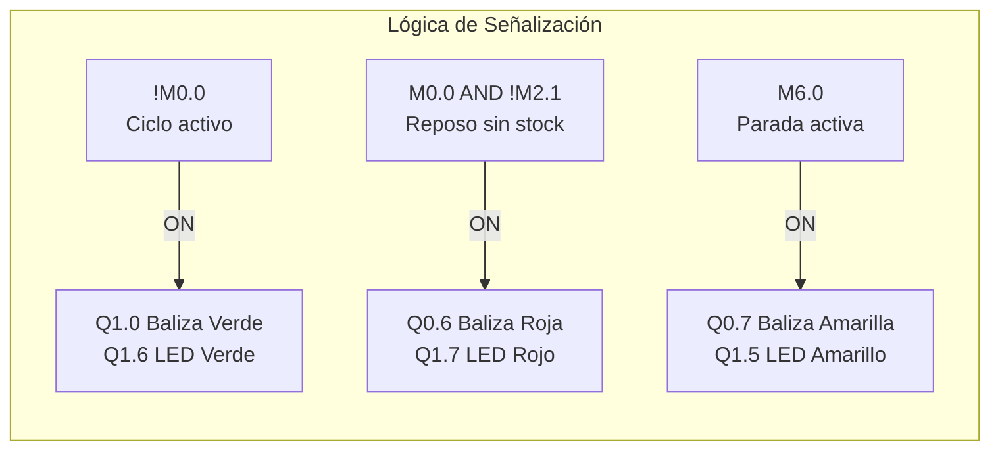

---

## Tabla de Plazas (referencia rápida)

| Plaza | Marca | Zona | Nombre | Descripción | Salidas Q activas |
|:---|:---|:---|:---|:---|:---|
| **P0** | **M0.0** | **Ctrl** | **Reposo** | **Estado inicial / post-emergencia** | **Q0.0 (inv.)** |
| P1 | M0.1 | Dosificador | Dos_Sujetar | Extiende cilindro superior (sujeta columna) | Q0.0, Q0.1 |
| P2 | M0.2 | Dosificador | Dos_Caída | Retrae cilindro inferior (libera pieza) | Q0.1 (Q0.0=OFF) |
| P3 | M0.3 | Dosificador | Dos_Restaurar | Extiende cilindro inferior (restaura) | Q0.0, Q0.1 |
| P4 | M0.4 | Mesa | Mesa_Giro | Gira mesa antihorario a posición de recogida | Q0.0, Q0.2 |
| P5 | M0.5 | Pick | Pick_Bajar | Baja brazo sobre pieza secundaria | Q0.0, Q0.2, Q0.4 |
| P6 | M0.6 | Pick | Pick_Agarrar | Cierra pinza para agarrar pieza | Q0.0, Q0.2, Q0.3, Q0.4 |
| P7 | M0.7 | Pick | Pick_Subir | Sube brazo con pieza agarrada | Q0.0, Q0.2, Q0.3 |
| P8 | M1.0 | Place | Place_Trans | Traslada brazo horizontalmente | Q0.0, Q0.3, Q0.5 |
| P9 | M1.1 | Place | Place_Bajar | Baja brazo sobre pieza receptora | Q0.0, Q0.3, Q0.4, Q0.5 |
| P10 | M1.2 | Place | Place_Soltar | Abre pinza y suelta pieza | Q0.0, Q0.4, Q0.5 |
| P11 | M1.3 | Place | Place_Subir | Sube brazo tras depositar pieza | Q0.0, Q0.5 |
| P12 | M1.4 | Reset | Reset_Arm | Retorna brazo atrás, mesa a origen | Q0.0 |

---

## Tabla de Transiciones (referencia rápida)

| Transición | Marca | Condición (AWL) | Acción principal |
|:---|:---|:---|:---|
| T0 | M4.0 | M0.0 AND M2.0 AND M2.1 AND M2.2 AND !M6.0 | R M0.0, S M0.1 |
| T1 | M4.1 | M0.1 AND M2.3 | R M0.1, S M0.2 |
| T2 | M4.2 | M0.2 AND M2.6 | R M0.2, S M0.3 |
| T3 | M4.3 | M0.3 AND M2.5 | R M0.3, S M0.4 |
| T4 | M4.4 | M0.4 AND M3.0 | R M0.4, S M0.5 |
| T5 | M4.5 | M0.5 AND M3.2 | R M0.5, S M0.6 |
| T6 | M4.6 | M0.6 AND M3.1 | R M0.6, S M0.7 |
| T7 | M4.7 | M0.7 | R M0.7, S M1.0 |
| T8 | M5.0 | M1.0 AND M3.5 | R M1.0, S M1.1 |
| T9 | M5.1 | M1.1 AND M3.2 | R M1.1, S M1.2 |
| T10 | M5.2 | M1.2 AND !M3.1 | R M1.2, S M1.3 |
| T11 | M5.3 | M1.3 | R M1.3, S M1.4 |
| T12 | M5.4 | M1.4 AND M3.4 AND M3.0 | R M1.4, S M0.0 |

---

## Marcado Inicial (Primer Scan)

Condición: SM0.1 = 1 (solo el primer ciclo de scan del PLC)

| Operación | Efecto |
|:---|:---|
| S M0.0, 1 | Activa P0 (marca inicial de la Red de Petri) |
| R M0.1..M1.7 | Garantiza que todas las plazas P1–P12 estén en 0 |
| R Q0.0..Q0.5 | Garantiza que todas las salidas físicas estén inactivas |

El sistema siempre arranca en estado **P0 (Reposo)** con todas las salidas inactivas.

---

## 5. Estación 4 — Procesamiento

---

## Leyenda
- **Círculos / Óvalos** = Plazas (estados estables, portadoras de marcas M)
- **Rectángulos** = Transiciones (eventos que cambian el estado)
- **Flechas sólidas** = Flujo de marcas
- **Flechas punteadas** = Condición de emergencia
- `[Mx.y]` = Marca de memoria interna asociada

---

## Diagrama Principal

```mermaid
flowchart TD

    %% =========================================================
    %% ARRANQUE
    %% =========================================================

    INIT(["SM0.1\nPrimer Scan"]):::init

    %% =========================================================
    %% ZONA 0: REPOSO
    %% =========================================================

    P0(["P0 - Reposo\n[M0.0]\nCarro en origen\nPinza abierta, sin pieza"]):::plaza_ctrl

    INIT -->|"S M0.0\nR M0.1..7"| P0

    %% =========================================================
    %% ZONA 1: SUJECIÓN Y TRASLADO ENTRADA
    %% =========================================================

    P1(["P1 - Sujeción\n[M0.1]\nPinza cierra sobre pieza\nQ0.0=1 Q1.0=1"]):::plaza_exec
    P2(["P2 - Traslación a Prensa\n[M0.2]\nCarro se desplaza hacia la prensa\nQ0.0=1 Q0.2=1 Q1.0=1"]):::plaza_exec

    T0["T0 - Inicio Ciclo\n[M1.0]\nM0.0 AND I1.3 AND I1.4 AND I0.0\n(Marcha + Seta OK + Pieza en origen)"]:::trans
    T1["T1 - Sujeción OK\n[M1.1]\nM0.1 AND I0.1\n(Pinza cerrada I0.1)"]:::trans
    T2["T2 - Carro en Prensa\n[M1.2]\nM0.2 AND I0.3\n(Cil_Lrg retraído I0.3)"]:::trans

    P0 --> T0
    T0 -->|"R M0.0\nS M0.1"| P1
    P1 --> T1
    T1 -->|"R M0.1\nS M0.2"| P2
    P2 --> T2

    %% =========================================================
    %% ZONA 2: CICLO DE PRENSADO (riesgo alto)
    %% =========================================================

    P3(["P3 - Prensado Baja\n[M0.3]\nPistón de prensa desciende\nQ0.0=1 Q0.2=1 Q0.3=1 Q1.0=1"]):::plaza_pick
    P4(["P4 - Prensado Sube\n[M0.4]\nPistón de prensa asciende\nQ0.0=1 Q0.2=1 Q1.0=1"]):::plaza_pick

    T3["T3 - Prensa Abajo\n[M1.3]\nM0.3 AND I0.5\n(Cil_Delgado extendido I0.5)"]:::trans
    T4["T4 - Prensa Arriba\n[M1.4]\nM0.4 AND I0.4\n(Cil_Delgado retraído I0.4)"]:::trans

    T2 -->|"R M0.2\nS M0.3"| P3
    P3 --> T3
    T3 -->|"R M0.3\nS M0.4"| P4
    P4 --> T4

    %% =========================================================
    %% ZONA 3: TRASLADO DE RETORNO
    %% =========================================================

    P5(["P5 - Traslación a Origen\n[M0.5]\nCarro retorna al origen con pieza\nQ0.0=1 Q1.0=1"]):::plaza_exec

    T5["T5 - Carro en Origen\n[M1.5]\nM0.5 AND I0.2\n(Cil_Lrg extendido I0.2)"]:::trans

    T4 -->|"R M0.4\nS M0.5"| P5
    P5 --> T5
    T5 -->|"R M0.5\nS M0.0"| P0

    %% =========================================================
    %% EMERGENCIA
    %% =========================================================

    EMERG(["EMERGENCIA\nI1.4 = 0\nSeta activa"]):::emerg

    P1 -.->|"NOT I1.4"| EMERG
    P2 -.->|"NOT I1.4"| EMERG
    P3 -.->|"NOT I1.4"| EMERG
    P4 -.->|"NOT I1.4"| EMERG
    P5 -.->|"NOT I1.4"| EMERG
    EMERG -.->|"R M0.1..7\nS M0.0\nR Q0.0..Q0.3\nQ1.1=1"| P0

    %% =========================================================
    %% ESTILOS
    %% =========================================================

    classDef plaza_ctrl   fill:#1f2e24,stroke:#16a34a,stroke-width:3px,color:#c9d1d9
    classDef plaza_exec   fill:#2e2c1f,stroke:#ca8a04,stroke-width:2px,color:#c9d1d9
    classDef plaza_pick   fill:#2e251f,stroke:#ea580c,stroke-width:2px,color:#c9d1d9
    classDef trans        fill:#161b22,stroke:#475569,stroke-width:1px,color:#c9d1d9
    classDef init         fill:#1e293b,stroke:#64748b,stroke-width:1px,color:#c9d1d9,stroke-dasharray:4
    classDef emerg        fill:#450a0a,stroke:#f87171,stroke-width:3px,color:#c9d1d9
```

> **⚠ Nota de seguridad:** P3 (Prensado Baja) es la plaza de mayor riesgo operativo.
> La emergencia por I1.4 = 0 tiene prioridad absoluta y detiene el ciclo desde cualquier estado.

---

## Tabla de Plazas (referencia rápida)

| Plaza | Marca | Nombre | Descripción | Salidas Q activas |
|:---|:---|:---|:---|:---|
| **P0** | **M0.0** | **Reposo** | **Estado inicial / post-emergencia** | **(ninguna)** |
| P1 | M0.1 | Sujeción | Pinza cierra sobre la pieza en origen | Q0.0, Q1.0 |
| P2 | M0.2 | Traslación_In | Carro se desplaza con pieza hacia la prensa | Q0.0, Q0.2, Q1.0 |
| P3 | M0.3 | Prensado_Baja | ⚠ Prensa desciende (operación de prensado) | Q0.0, Q0.2, Q0.3, Q1.0 |
| P4 | M0.4 | Prensado_Sube | Prensa asciende, carro permanece en prensa | Q0.0, Q0.2, Q1.0 |
| P5 | M0.5 | Traslación_Out | Carro retorna a origen con pieza sujeta | Q0.0, Q1.0 |

---

## Tabla de Transiciones (referencia rápida)

| Transición | Marca | Condición (AWL) | Acción principal |
|:---|:---|:---|:---|
| T0 | M1.0 | M0.0 AND I1.3 AND I1.4 AND I0.0 | R M0.0, S M0.1 |
| T1 | M1.1 | M0.1 AND I0.1 | R M0.1, S M0.2 |
| T2 | M1.2 | M0.2 AND I0.3 | R M0.2, S M0.3 |
| T3 | M1.3 | M0.3 AND I0.5 | R M0.3, S M0.4 |
| T4 | M1.4 | M0.4 AND I0.4 | R M0.4, S M0.5 |
| T5 | M1.5 | M0.5 AND I0.2 | R M0.5, S M0.0 |

---

## Tabla de Sensores por Plaza (referencia rápida)

| Plaza | Sensor de llegada | Dirección | Descripción |
|:---|:---|:---|:---|
| P0 | (marcado inicial) | — | Activado por SM0.1 o retorno de T5 |
| P1 | I0.1 | M2.2 | Pinza cerrada confirmada |
| P2 | I0.3 | M2.4 | Cilindro largo retraído = carro en prensa |
| P3 | I0.5 | M2.5 | Cilindro delgado extendido = prensa abajo |
| P4 | I0.4 | M2.6 | Cilindro delgado retraído = prensa arriba |
| P5 | I0.2 | M2.3 | Cilindro largo extendido = carro en origen |

---

## Comportamiento de Emergencia

| Condición | Acción AWL | Efecto en el sistema |
|:---|:---|:---|
| I1.4 = 0 (seta pulsada) | Omite asignación de salidas | Q0.0..Q0.3 = 0 (todos los actuadores paran) |
| I1.4 = 0 en bloque EMERG | R M0.1..7, S M0.0 | Resetea todas las plazas, activa P0 (Reposo) |
| Señal Q1.1 en emergencia | NOT I1.4 en condición | Baliza roja activa |
| Recuperación | Liberar seta (I1.4 → 1) | Sistema en P0, listo para nuevo ciclo |

---

## Marcado Inicial (Primer Scan)

Condición: SM0.1 = 1 (solo el primer ciclo de scan del PLC)

| Operación | Efecto |
|:---|:---|
| S M0.0, 1 | Activa P0 (marca inicial de la Red de Petri) |
| R M0.1, 7 | Garantiza que P1..P5 estén en 0 |

El sistema siempre arranca en estado **P0 (Reposo)** con todas las salidas inactivas.

---

## 6. Estación 5 — Selección

---

## Leyenda
- **Círculos / Óvalos** = Plazas (estados estables, portadoras de marcas M)
- **Rectángulos** = Transiciones (eventos que cambian el estado)
- **Flechas sólidas** = Flujo de marcas
- **Flechas punteadas** = Condición de emergencia o lazo de control
- `[Mx.y]` = Marca de memoria interna asociada

---

## Diagrama Principal

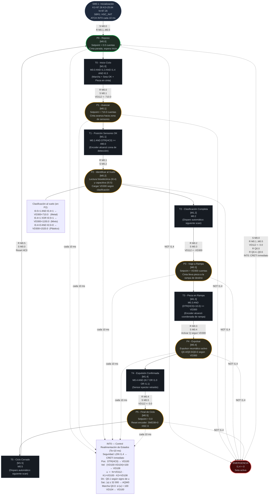

---

## Mapa de Clasificación al Vuelo

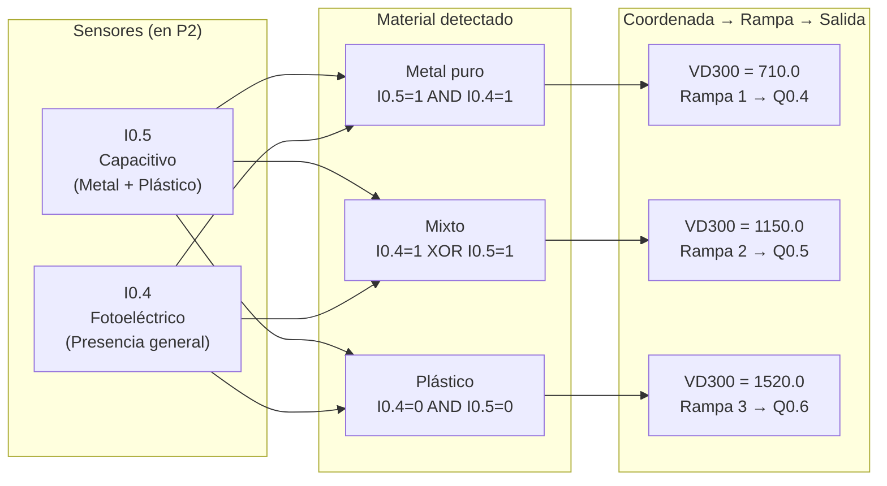

---

## Tabla de Plazas (referencia rápida)

| Plaza | Marca | Nombre | Setpoint VD112 | Descripción |
|:---|:---|:---|:---|:---|
| **P0** | **M0.0** | **Reposo** | **0.0** | **Estado inicial / post-emergencia** |
| P1 | M0.1 | Avanzar | 710.0 | Cinta avanza hacia zona de sensores |
| P2 | M0.2 | Identificar | Sin cambio | Lee I0.4 e I0.5, carga VD300 según clasificación |
| P3 | M0.3 | Viaje | VD300 | Cinta lleva pieza hasta la coordenada de la rampa |
| P4 | M0.4 | Expulsar | Sin cambio | Activa Q0.4, Q0.5 o Q0.6 según VD300 |
| P5 | M0.5 | Final | 0.0 | Reset encoder: SMD38=0, HSC 0 |

---

## Tabla de Transiciones (referencia rápida)

| Transición | Marca | Condición (AWL) | Acción principal |
|:---|:---|:---|:---|
| T0 | M1.0 | M0.0 AND I1.3 AND I1.4 AND I0.3 | R M0.0, S M0.1, VD112←710.0 |
| T1 | M1.1 | M0.1 AND (DTR HC0 AR>= 490.0) | R M0.1, S M0.2 |
| T2 | M1.2 | M0.2 (automático, siguiente scan) | R M0.2, S M0.3, VD112←VD300 |
| T3 | M1.3 | M0.3 AND (DTR HC0 +R 10.0 AR>= VD300) | R M0.3, S M0.4, Activar eyector |
| T4 | M1.4 | M0.4 AND (I0.7 OR I1.0 OR I1.1) | R M0.4, S M0.5, VD112←0.0 |
| T5 | M1.5 | M0.5 (automático, siguiente scan) | R M0.5, S M0.0, Reset HC0 |

---

## Tabla de Coordenadas de Rampa

| Material | I0.5 | I0.4 | VD300 (cuentas) | Cilindro | Salida |
|:---|:---:|:---:|:---|:---|:---|
| Metal puro | 1 | 1 | 710.0 | Rampa 1 | Q0.4 |
| Mixto | 1 | 0 | 1150.0 | Rampa 2 | Q0.5 |
| Mixto | 0 | 1 | 1150.0 | Rampa 2 | Q0.5 |
| Plástico | 0 | 0 | 1520.0 | Rampa 3 | Q0.6 |

---

## Parámetros del Controlador de Estados

| Parámetro | Variable | Valor | Descripción |
|:---|:---|:---|:---|
| K1 | VD120 | 97.26 | Ganancia de realimentación de posición |
| K2 | VD124 | 25.64 | Ganancia de realimentación de velocidad |
| N | VD132 | 97.26 | Ganancia de pre-compensación de referencia |
| Ts | SMB34 | 10 ms | Período de muestreo (interrupción temporizada) |
| Sat. máx | — | 32 000 | Saturación de la acción de control (= 10 V) |
| Zona muerta | — | 100 | Umbral mínimo de acción para activar motor |

---

## Comportamiento de Emergencia

| Condición | Acción AWL | Efecto en el sistema |
|:---|:---|:---|
| I1.4 = 0 (seta pulsada) | INT0: CRETI inmediato | Lazo de control se detiene al instante |
| I1.4 = 0 en bloque EMERG | S M0.0, R M0.1..M0.5 | Resetea todas las plazas, activa P0 (Reposo) |
| VD112 en emergencia | VD112 ← 0.0 | Setpoint a cero: cinta se frena |
| Eyectores en emergencia | R Q0.4..Q0.6 | Todos los cilindros se retraen |
| Recuperación | Liberar seta (I1.4 → 1) | Sistema en P0, listo para nuevo ciclo |

