# Exposición de Resultados de Laboratorio
## Etapa 1: Instrumentación, Planos P&ID y Comunicaciones Industriales (Labs 1-3)

**Estudiantes:**
* Univ. Herrera Tola Gabriel Sebastian (ETN1034)
* Univ. Mamani Tola José Aldin (ETN1034)
* Univ. Quispe Mamani Leonardo Darwin (ETN902)
* Univ. Monzon Hidalgo Josue (ETN902)

**Docente:** Ing. Jorge Antonio Nava Amador
**Auxiliares:** Aux. Limber Ajnota Cahuaya / Aux. Fabian Plata Vargas

---

# Laboratorio 1: Reconocimiento de Sistemas y Variables
## El Desafío y Estructura de la Planta Flexible XK-335B
* **El Desafío:** Identificar, clasificar y analizar las variables físicas y los lazos de control de la planta de manufactura flexible.
* **Estructura Modular del Proceso:**
  1. *Unidad de Alimentación (Estación 1):* Dosificación y entrega de cuerpos base.
  2. *Unidad de Procesamiento (Estación 2):* Simulación de prensado/estampado de piezas.
  3. *Unidad de Ensamblaje (Estación 3):* Alimentación y montaje por presión de tapas.
  4. *Unidad de Transporte (Estación 4):* Nexus logístico con carro lineal y brazo.
  5. *Unidad de Selección (Estación 5):* Cinta y desvíos por tipo de material.

---

# Laboratorio 1: Diagrama de Bloques General
* **Estructura Causal del Sistema:**
  * Modelado de las relaciones entrada-salida para comprender el flujo de señales digitales y analógicas.
  * La **Unidad de Transporte** actúa como el eje transversal del proceso, requiriendo coordinación física con las estaciones periféricas.
  * *Punto de Consigna:* Solicitud de manufactura de una pieza específica.
  * *Salida:* Pieza procesada y clasificada correctamente.

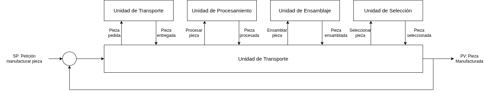

---

# Laboratorio 1: Unidad de Alimentación
* **Lazo de Control Secuencial:**
  * *Variable Manipulada (MV):* Voltaje digital de las electroválvulas `Airtac 4V120-06`.
  * *Variable de Proceso (PV):* Presencia de la pieza expulsada y en silo.
  * *Retroalimentación:* Sensores fotoeléctricos infrarrojos y magnéticos de fin de carrera de cilindros.

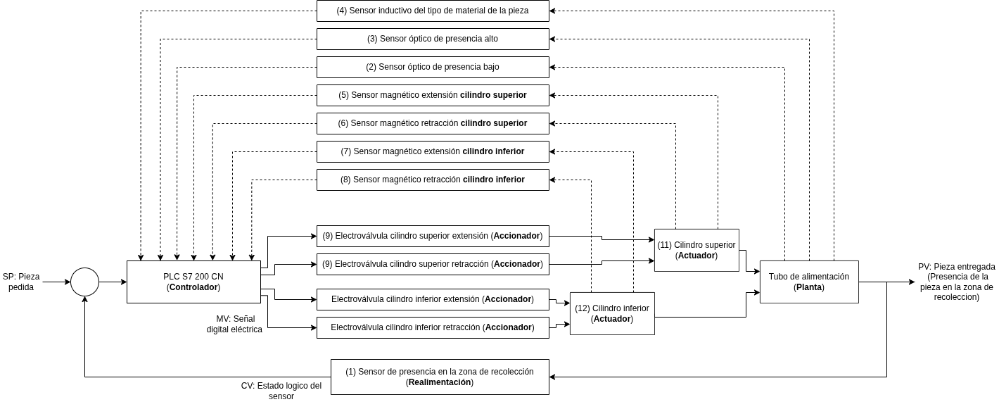

---

# Laboratorio 1: Unidad de Transporte
* **Lazo de Posicionamiento y Sujeción:**
  * *Variable Manipulada (MV):* Señal de consigna del servomotor y bobinas.
  * *Variable de Proceso (PV):* Posición lineal del carro móvil y estado de pinza.
  * *Retroalimentación:* Encoder incremental rotativo Panasonic y sensores de vástago.

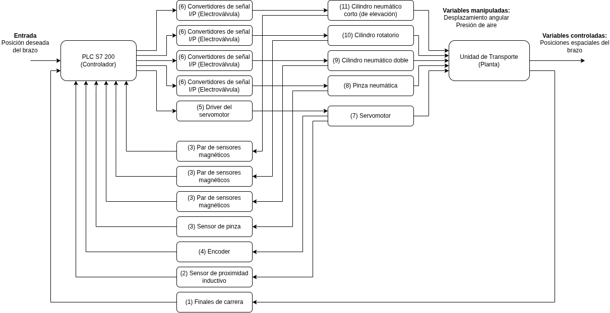

---

# Laboratorio 1: Unidad de Procesamiento
* **Lazo de Prensado y Fijación:**
  * *Variable Manipulada (MV):* Consignas discretas de cilindros neumáticos.
  * *Variable de Proceso (PV):* Presencia de la pieza y estado de la prensa.
  * *Retroalimentación:* Sensores magnéticos de vástago y sensor fotoeléctrico de base.

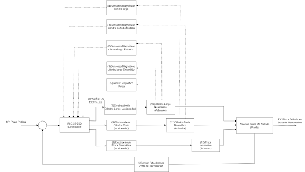

---

# Laboratorio 1: Unidad de Ensamblaje
* **Lazo de Alimentación y Montaje:**
  * *Variable Manipulada (MV):* Señales digitales para el pistón superior, inferior, rotatorio y de pinza.
  * *Variable de Proceso (PV):* Tapa ensamblada físicamente.
  * *Retroalimentación:* Fibra óptica Omron y sensores magnéticos de fin de carrera.

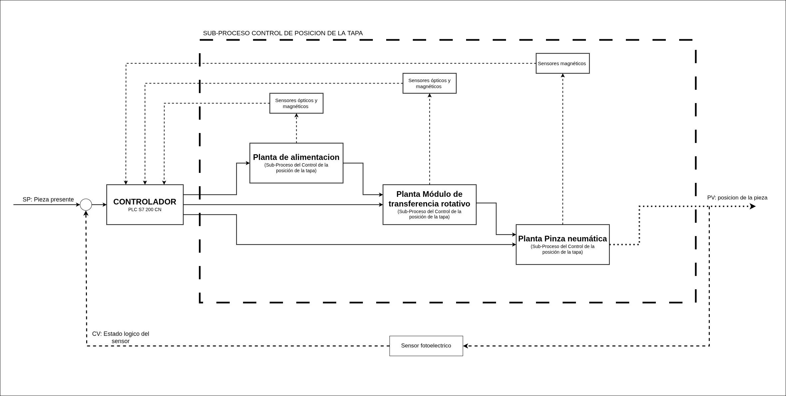

---

# Laboratorio 1: Unidad de Selección
* **Lazo de Clasificación y Velocidad:**
  * *Variable Manipulada (MV):* Deflectores neumáticos y consigna analógica de velocidad `AQW0`.
  * *Variable de Proceso (PV):* Posición de desvío de la pieza por material.
  * *Retroalimentación:* Encoder incremental de banda, sensor inductivo y capacitivo.

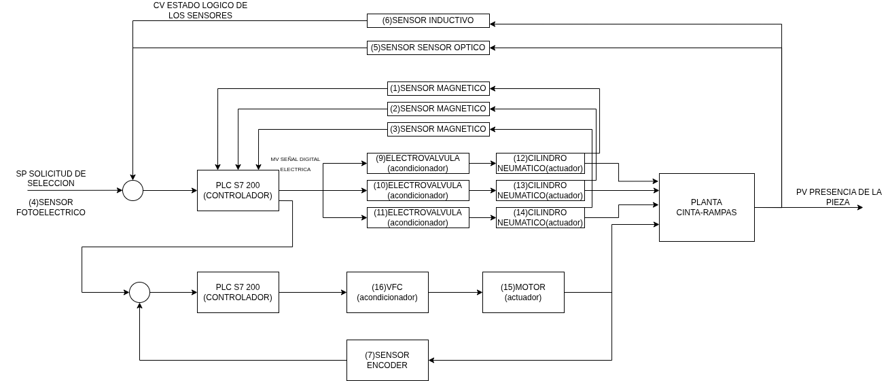

---

# Laboratorio 1: Instrumentación de Campo Identificada
* **Sensores de Proximidad Magnéticos (SMC D-C73):** Instalados en cilindros neumáticos para retroalimentación interna de la secuencia (lazo cerrado de control secuencial).
* **Sensores Ópticos Difusos (Omron E3Z-LS61):** Detección de presencia en silos, mesas de transferencia y rampas.
* **Sensor de Fibra Óptica (Omron E3X-NA41):** Alta sensibilidad para detección de recipientes pequeños y colores.
* **Sensor Inductivo (LM18-3008NA):** Detección de presencia metálica.
* **Encoder Incremental (ZSP 3806):** Retroalimentación de la cinta transportadora.
* **Actuadores Neumáticos:** Cilindros de doble efecto estándar, cilindros de guía paralela y pinzas neumáticas de sujeción (MHZ2-20D).

---

# Laboratorio 1: Competencias Adquiridas
* **Diferenciación de Variables en Entornos Reales:** Habilidad para aislar e identificar variables controladas (PV), manipuladas (MV) y perturbaciones (DV) en lazos de control de eventos discretos y analógicos.
* **Clasificación de Instrumentación Industrial:** Reconocimiento de los principios físicos de operación de sensores fotoeléctricos, magnéticos, inductivos, de fibra óptica y encoders incrementales.
* **Esquematización en Bloques Funcionales:** Capacidad para estructurar diagramas de bloques que describan la causalidad dinámica de un sistema electromecánico distribuido.

---

# Laboratorio 2: Simbología, P&ID y Esquemas Eléctricos
## El Desafío de Ingeniería de Diseño Normalizado
* **El Desafío:** Corregir y completar la documentación de planos previos de semestres anteriores (pobres conceptualmente e incompletos) aplicando normas internacionales.
* **Lazos de Instrumentación (Norma ISA-5.1):**
  * Diseño de planos de tuberías e instrumentación (P&ID) para cada una de las estaciones.
  * Representación normalizada de señales eléctricas, neumáticas y lógicas de software.
* **Esquemas Multifilares (Normas IEC / IEEE):**
  * Elaboración en **AutoCAD Electrical** de los esquemas de alimentación (220 VAC / 24 VDC), protecciones eléctricas y conexionado físico I/O del PLC S7-200.

---

# Laboratorio 2: P&ID - Unidad de Alimentación
* **Lazo de Dosificación:**
  * Válvulas solenoides de control de cilindros de doble efecto (`AIRTAC 4V120-06`) y de la pinza de alimentación.
  * Representación del flujo de aire comprimido (señales neumáticas) regulado por las unidades de mantenimiento (FRL).

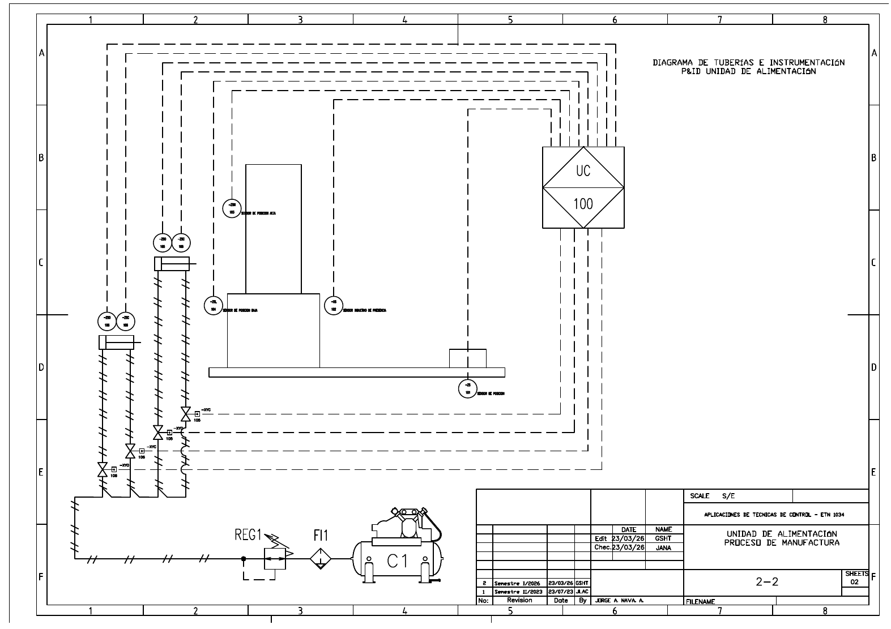

---

# Laboratorio 2: P&ID - Unidad de Ensamblaje
* **Lazo de Alimentación y Montaje:**
  * Simbología de actuadores y sensores para el control neumático rotatorio, cilindro vertical, horizontal y pinza de sujeción.
  * Mapeo de la lógica física bajo norma ISA-5.1.

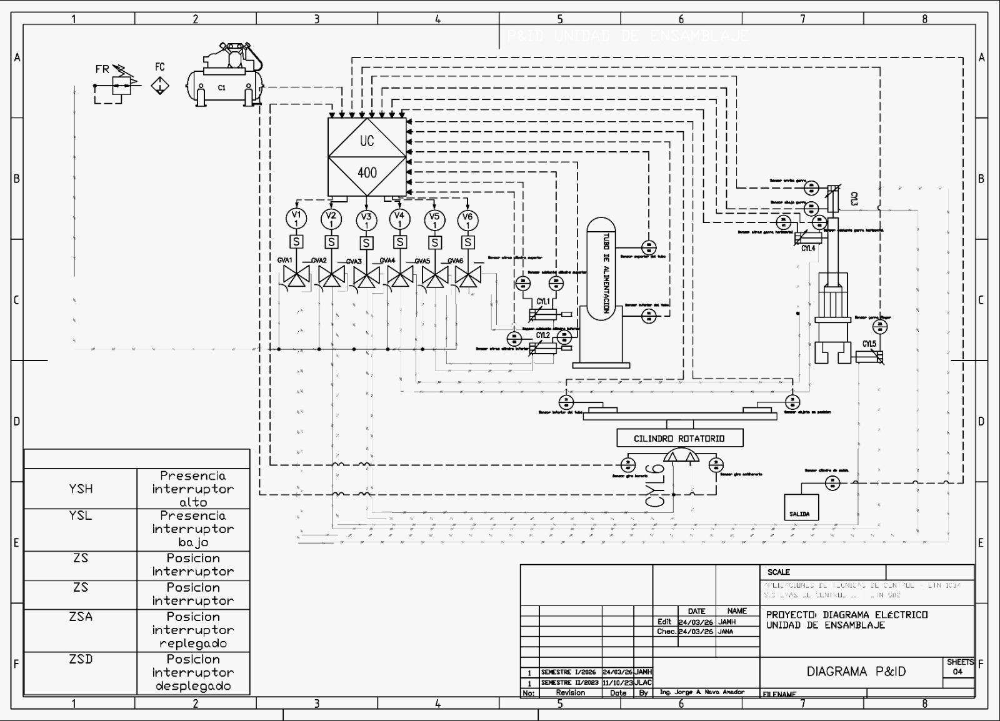

---

# Laboratorio 2: P&ID - Unidad de Transporte
* **Lazo de Desplazamiento Lineal:**
  * Representación del carro móvil con servomotor Panasonic, brazo neumático vertical y pinzas de sujeción final.
  * Cableado de lógica neumática.

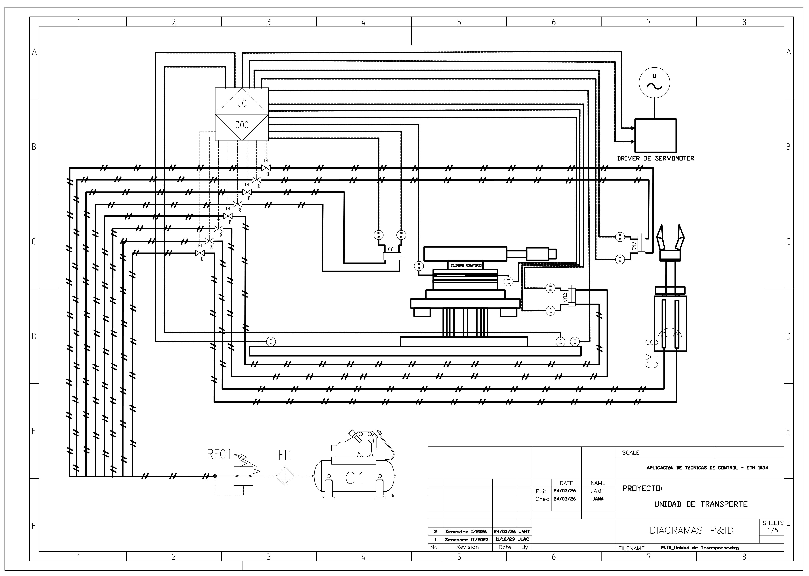

---

# Laboratorio 2: P&ID - Unidad de Selección
* **Lazo de Cinta y Desvíos:**
  * Representación del motor asíncrono controlado por variador Powtran, deflectores de clasificación neumática y lazos sensores.

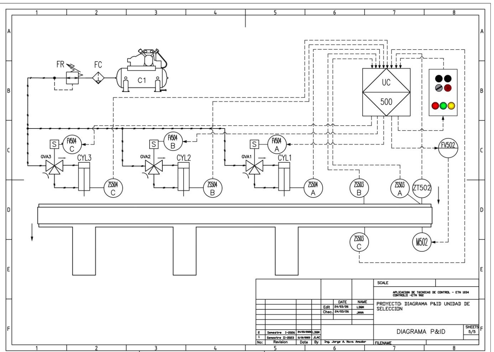

---

# Laboratorio 2: Diagrama Eléctrico - Unidad de Alimentación
* **Distribución de Alimentación y Sensores:**
  * Conexiones de control de sensores fotoeléctricos e inductivos NPN/PNP.
  * Protecciones eléctricas.

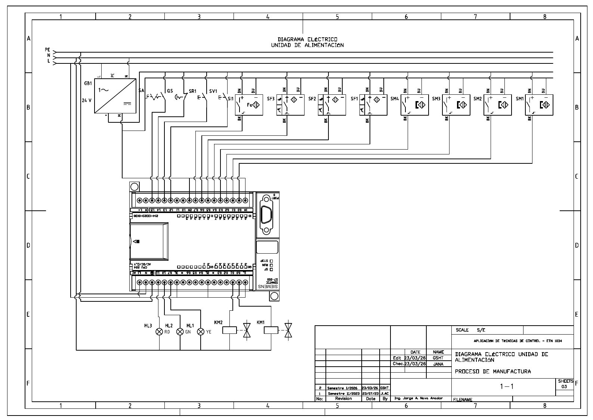

---

# Laboratorio 2: Diagrama Eléctrico - Unidad de Ensamblaje
* **Conexionado I/O de la Estación 3:**
  * Cableado de entradas digitales (24 VDC) para sensores magnéticos y Omron de fibra óptica.
  * Distribución de bornes del PLC.

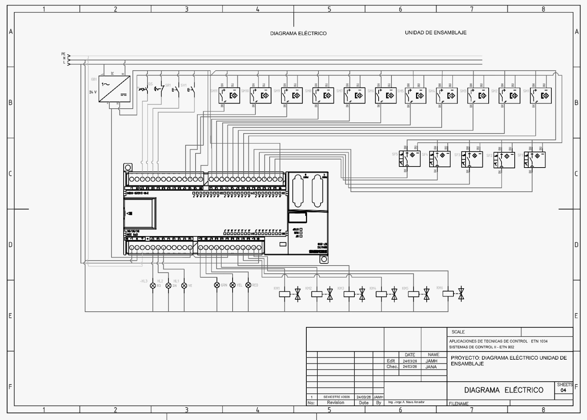

---

# Laboratorio 2: Diagrama Eléctrico - Unidad de Transporte
* **Alimentación y Control del Servodriver:**
  * Detalle de la interconexión del driver Panasonic MADDT1207 con las salidas rápidas y bobinas digitales del PLC.

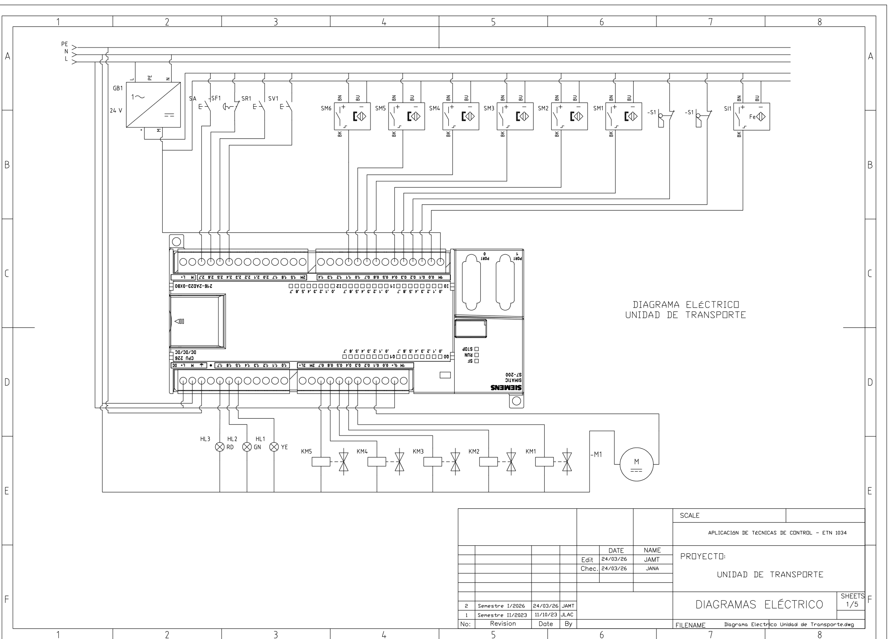

---

# Laboratorio 2: Diagrama Eléctrico - Unidad de Selección
* **Conexionado de Potencia y Control del Motor:**
  * Conexión trifásica del motor asíncrono y cableado de relés del PLC hacia el variador Powtran.

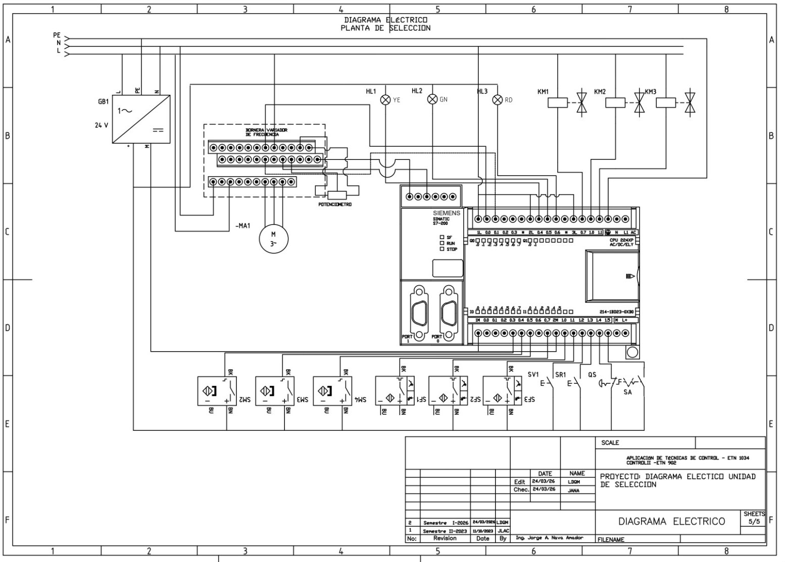

---

# Laboratorio 2: Competencias Adquiridas
* **Dominio de CAD Eléctrico Industrial:** Habilidad para usar AutoCAD Electrical en la elaboración de diagramas de potencia, control y borneras con rotulación y referencias automáticas.
* **Aplicación de Normas Internacionales:** Capacidad para aplicar e interpretar simbología normalizada ISA-5.1 (instrumentación) e IEC/IEEE (eléctrica).
* **Estructuración de Planos de Mantenimiento:** Habilidad para generar planos limpios y estandarizados que reduzcan el tiempo de diagnóstico y localización de fallas en cables de campo o sensores.

---

# Laboratorio 3: Elementos en Sistemas de Control
## Acondicionamiento y Redes de Comunicación Industrial
* **El Desafío:** Acoplar la electrónica de control de baja potencia del PLC con actuadores de potencia, y diseñar la red de comunicación de la planta flexible para supervisión HMI.
* **Acondicionamiento y Potencia:**
  * *Driver Servomotor Panasonic MADDT1207:* Convierte la alimentación alterna en salida controlada de 90.3 VDC para el servomotor del carro (Unidad de Transporte).
  * *Variador de Frecuencia Powtran PI9100A:* Escala la señal analógica del PLC (`AQW0` de 0-10V) a una frecuencia de 0-60 Hz para modular la velocidad del motor trifásico de la cinta.
  * *Medición de Voltaje:* Verificación de voltajes nominales de entradas PNP del PLC a 24 VDC.

---

# Laboratorio 3: Mediciones de Tensión en Sensores
* **Enfoque de Verificación Eléctrica:**
  * Se comprobó la tensión física de las entradas para validar la compatibilidad de los sensores con la CPU S7-200.
  * *Umbrales:* Lógica `1` activa en un rango de 22-24 VDC.

| Dirección | Sensor / Dispositivo | Variable | Val. Esperado | Val. Medido |
| :---: | :--- | :---: | :---: | :---: |
| **I0.4** | Sensor fotoeléctrico (Pieza base) | Presencia | 22-24 VDC | **23.17 V** |
| **I0.7** | Sensor inductivo (Detección metal) | Material | 22-24 VDC | **24.02 V** |
| **I1.4** | Seta de emergencia (NC) | Seguridad | 22-24 VDC | **24.04 V** |
| **I1.2** | Pulsador de marcha (Verde) | Arranque | 22-24 VDC | **24.04 V** |

---

# Laboratorio 3: Arquitectura Daisy Chain RS-485
* **Red Local PPI (Daisy Chain):** Conexión en cadena (RS-485) entre todos los PLCs de la planta. El PLC Coordinador (Estación 4) utiliza instrucciones de red **`NETR`** y **`NETW`** para leer/escribir estados de control y sincronizar el proceso.
* **Red Modbus RTU para HMI:** Conecta el bus de campo con una pasarela serie RS-485 a USB. El HMI MCGS legacy se conectaba localmente, pero se estableció la transición a un HMI basado en tecnologías web remotas.

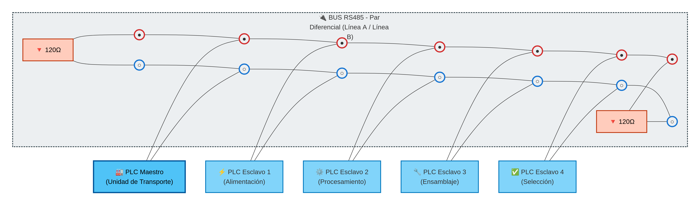

---

# Laboratorio 3: Transición de Interfaces de Supervisión
* **Legacy HMI MCGS (TPC7062KX):**
  * Pantalla táctil industrial local programada para supervisión directa y control manual de actuadores.
  * Limitada por distancia física y concurrencia.
* **Hacia el Control Centralizado SCADA:**
  * La desactivación del HMI local legacy habilitó el uso de la pasarela Modbus RTU hacia un servidor de supervisión web remoto, permitiendo visualización múltiple y telemetría de variables.

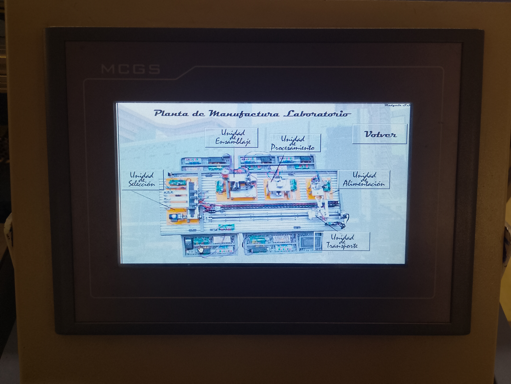

---

# Laboratorio 3: Competencias Adquiridas
* **Acondicionamiento de Potencia:** Configuración e interconexión de variadores de frecuencia (parámetros de límites de frecuencia a 60 Hz, modo de 2 hilos tipo 2) y servodrivers de CA comerciales.
* **Diseño e Implementación de Redes RS-485:** Comprensión de la topología Daisy Chain y del protocolo industrial maestro-esclavo PPI mediante comandos de red del S7-200.
* **Transición de Interfaces de Usuario:** Habilidad para planificar la migración de terminales HMI locales a arquitecturas de control web distribuidas en red local.
