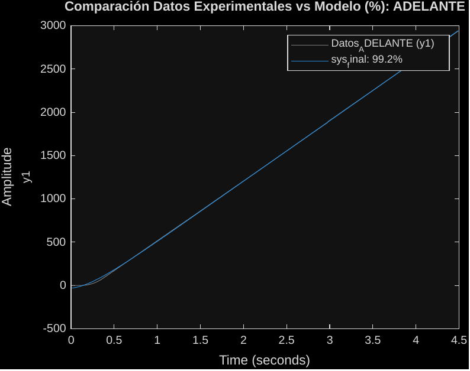
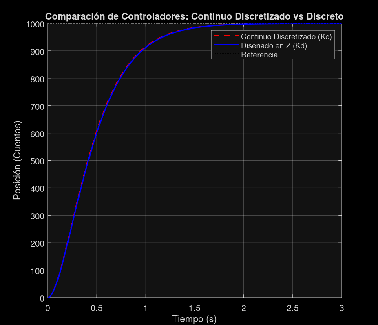
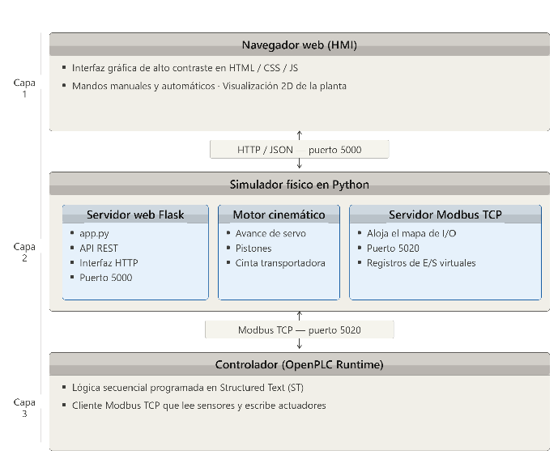
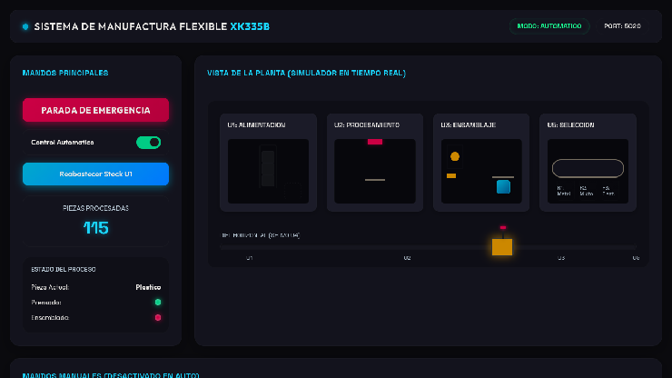
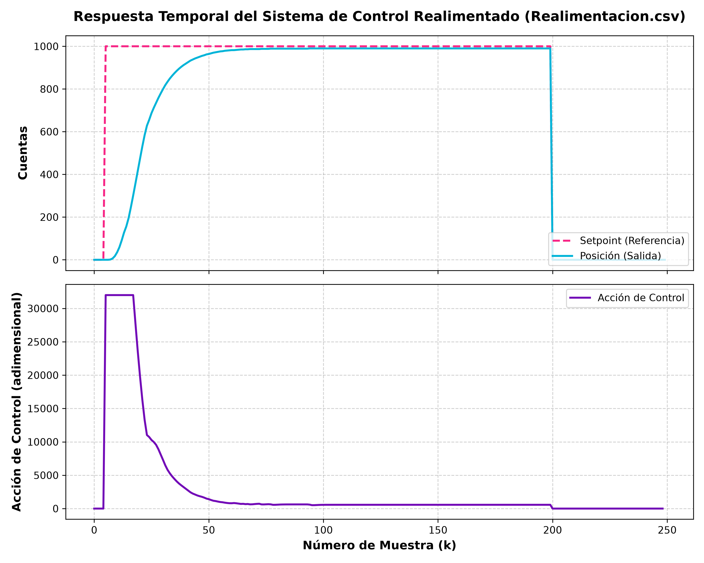
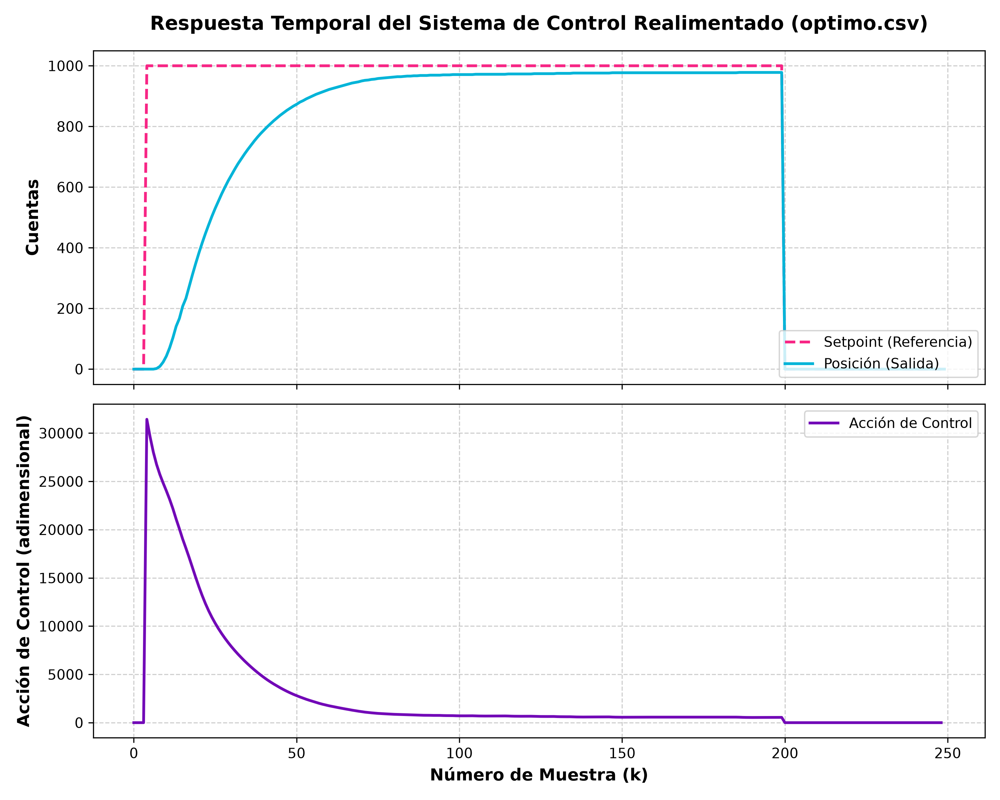

# Exposición de Resultados de Laboratorio
## Etapa 2: Modelado Dinámico y Control Moderno en Lazo Cerrado (Labs 4-8)

**Estudiantes:**
* Univ. Herrera Tola Gabriel Sebastian (ETN1034)
* Univ. Mamani Tola José Aldin (ETN1034)
* Univ. Quispe Mamani Leonardo Darwin (ETN902)
* Univ. Monzon Hidalgo Josue (ETN902)

**Docente:** Ing. Jorge Antonio Nava Amador
**Auxiliares:** Aux. Limber Ajnota Cahuaya / Aux. Fabian Plata Vargas

---

# Laboratorio 4: Modelado Matemático e Identificación
## Caracterización Dinámica de la Unidad de Selección
* **El Desafío:** Obtener un modelo dinámico preciso del conjunto variador-motor-cinta de la Unidad de Selección.
* **Comportamiento Cinético:** 
  * La entrada es la consigna de velocidad ($u$, unidades PLC en `AQW0`).
  * La salida es el conteo acumulado de pulsos del encoder ($y$, en `HC0`).
  * El sistema se comporta como un **integrador puro con inercia** (sistema marginalmente estable).
  * Estructura dinámica de segundo orden:
    $$G(s) = \frac{K_v}{s(\tau s + 1)} = \frac{b}{s^2 + as}$$

---

# Laboratorio 4: Adquisición Determinista sin Jitter
* **El Reto de Adquisición:** La comunicación serie OPC con Excel generaba demoras y variaciones en el tiempo de muestreo (*jitter*), destruyendo los datos de identificación.
* **La Solución en el PLC S7-200:**
  * Uso de la interrupción temporizada de hardware **`SMB34`** configurada estrictamente a **10 ms** ($T_s = 0.01\text{ s}$).
  * Conexión asíncrona del encoder en cuadratura (1x) al contador rápido integrado **`HSC0`** en Modo 9.
  * Almacenamiento directo en el buffer de memoria V usando **punteros** (`&VD0` de la CPU).
* **Copiado de Datos:** Debido a problemas en la red OPC, **los datos de posición se copiaron manualmente desde la tabla de estado de Step 7 a una hoja de datos en Excel** para realizar la identificación en MATLAB.

---

# Laboratorio 4: Modelos Dinámicos Identificados
* **Modelos en el Dominio de la Frecuencia (Función de Transferencia):**
  * *Sentido Adelante (Forward):* $G_{fwd}(s) = \frac{0.1642}{s^2 + 3.764s} = \frac{0.0436}{s(0.2657s + 1)}$
  * *Sentido Atrás (Backward):* $G_{bwd}(s) = \frac{-0.1618}{s^2 + 3.716s} = \frac{-0.0435}{s(0.2691s + 1)}$
* **Representación en Espacio de Estados (Forma Compañera):**
  * *Forward:* $\dot{x}(t) = \begin{bmatrix} 0 & 1 \\ 0 & -3.7638 \end{bmatrix} x(t) + \begin{bmatrix} 0 \\ 0.1642 \end{bmatrix} u(t)$
  * *Backward:* $\dot{x}(t) = \begin{bmatrix} 0 & 1 \\ 0 & -3.7159 \end{bmatrix} x(t) + \begin{bmatrix} 0 \\ -0.1618 \end{bmatrix} u(t)$
* **Constante de Tiempo del Sistema ($\tau$):**
  * La constante de tiempo promedio es **$\tau \approx 0.267\text{ s}$** ($267\text{ ms}$), reflejando la inercia del motor y la rapidez de respuesta de velocidad del variador Powtran.

---

# Laboratorio 4: Competencias Adquiridas
* **Identificación Experimental Paramétrica:** Habilidad en la preparación de datos experimentales de entrada-salida y estimación de modelos dinámicos en MATLAB.
* **Programación Crítica de Adquisición:** Dominio de las funciones de interrupción temporizada de hardware y almacenamiento asíncrono contiguo mediante punteros en el PLC.
* **Análisis de Propiedades Estructurales:** Validación de estabilidad interna (Lyapunov), rango de la matriz de controlabilidad ($rank = 2$) y observabilidad.

---

# Laboratorio 5: Control Digital por Realimentación
## Diseño e Implementación de Posicionamiento Lazo Cerrado
* **Justificación del Tiempo de Adquisición (10ms):**
  * Basado en la constante de tiempo obtenida $\tau \approx 267\text{ ms}$.
  * Regla de diseño: $T_s \le \frac{\tau}{10} \approx 26.7\text{ ms}$. Elegir **$T_s = 10\text{ ms}$** garantiza una excelente captura de la dinámica transitoria rápida.
* **Justificación de los Polos Continuos (Polos Reales):**
  * Se seleccionaron polos reales dominantes en $p_s = [-4.0, -4.1]\text{ rad/s}$ ($p_z = [0.9608, 0.9598]$).
  * Los polos reales aseguran una respuesta **críticamente amortiguada o sobreamortiguada ($\zeta \ge 1$) sin sobreimpulso ($M_p = 0\%$)**. Esto evita que la pieza se deslice por inercia en la cinta al frenar.

---

# Laboratorio 5: Cálculo de Ganancias y Estimación
* **Método de Obtención de Ganancias:**
  * Se utilizó la **Fórmula de Ackermann** (función `place` en MATLAB) para la asignación exacta de polos discretos.
  * *Ganancia del Regulador:* $K_d = \begin{bmatrix} 97.7436 & 25.8460 \end{bmatrix}$
  * *Precompensación de Referencia:* $N_d = 97.7436$
* **Estimador de Velocidad por Diferencias Retroactivas:**
  * Al no tener sensor de velocidad, se implementó la solución matemática más simple y eficiente en coma flotante en el PLC (`VD108`):
    $$x_2[k] \approx \frac{x_1[k] - x_1[k-1]}{T_s} = 100 \cdot (x_1[k] - x_1[k-1])$$

---

# Laboratorio 5: Seguridad y Zona Muerta del Relé
* **Saturación de Seguridad:** Magnitud de acción de control acotada estrictamente a $\pm 32000$ unidades analógicas (`AQW0`).
* **Implementación de Zona Muerta (Evitar Chattering):**
  * Debido a que el PLC utiliza salidas digitales tipo relé para el mando de marcha/paro (`Q0.0`), la conmutación de alta velocidad las desgastaría rápidamente.
  * Se implementó una **zona muerta de $\pm 100$ unidades analógicas**.
  * Si la magnitud de la acción de control cae por debajo de 100 unidades, el PLC apaga `Q0.0` inmediatamente, previniendo chattering en estado estacionario.

---

# Laboratorio 5: Simulación y Respuesta en Lazo Cerrado
* **Simulación Teórica vs Métodos de Hardware Legacy:**
  * En semestres anteriores se requería armar convertidores F/V en hardware y calibrar en osciloscopio.
  * La derivada digital en software simplificó el hardware y mejoró la rigidez del lazo.
  * El diseño directo en Z (línea azul) elimina el leve sobreimpulso del método continuo discretizado directo (Kc).

---

# Laboratorio 5: Competencias Adquiridas
* **Diseño Digital en el Plano Z:** Discretización ZOH de modelos continuos e inyección directa de polos lógicos en el círculo unitario.
* **Aritmética en Punto Flotante en PLC:** Programación de leyes de control en coma flotante y conversiones en cascada (`ROUND` y `DTI` con acumuladores `AC0`/`AC1`) para evitar desbordes en el microprocesador.
* **Robustez ante Perturbaciones:** Comprobación física de la rigidez de control ante perturbación de torque aplicada manualmente en la cinta.

---

# Laboratorio 6: Structured Text y Gemelos Digitales
## Simulación Ciberfísica y Programación ST
* **El Desafío:** Validar la programación secuencial distribuida de la planta en una HMI moderna sin riesgo de colisiones destructivas en la planta real.
* **La Solución (Gemelo Digital):**
  * Migración del programa secuencial al lenguaje **Structured Text (ST)** bajo la norma **IEC 61131-3** en OpenPLC.
  * Desarrollo en Python de un **simulador cinemático en tiempo real** de la planta XK-335B.
  * Conexión en bucle de red local mediante el protocolo industrial **Modbus TCP**.

---

# Laboratorio 6: Stack Tecnológico y Gemelo Digital
* **Stack de Desarrollo:** OpenPLC (Structured Text IEC 61131-3), Python Flask (HMI Web) y Modbus TCP (`pyModbusTCP` en puerto `5020`).
* **Aclaración del Gemelo Digital:**
  * El simulador desarrollado en Python emula estrictamente el **comportamiento del proceso secuencial** (desplazamientos de piezas y cambios lógicos de sensores al llegar a límites).
  * **No modela las variables físicas dinámicas** (tales como la presión de aire comprimido, inercia física del pistón, rozamiento de guías o pérdidas de carga neumáticas).

---

# Laboratorio 6: Programación ST y Máquina de Estados
* **Máquina de 20 Estados (`CASE Step OF`):**
  * Control del ciclo automático secuencial de producción.
* **Soluciones Lógicas Clave:**
  * *Inicialización de Bobinas:* Reset de salidas en cada scan para evitar actuadores retenidos.
  * *Bloques TON Incondicionales:* Declarados fuera del condicional `CASE` para evitar la congelación del temporizador interno.
  * *Temporizador de Deflectores:* Mantener cinta activa por 3 segundos para el deslizamiento completo por gravedad de las piezas.

---

# Laboratorio 6: Competencias Adquiridas
* **Programación Estandarizada IEC 61131-3:** Uso avanzado de Structured Text para estructurar secuencias automáticas industriales.
* **Desarrollo de Gemelos Digitales:** Programación de simuladores cinemáticos con comportamiento físico de actuadores mediante código abierto (Python).
* **Integración de Redes Ethernet Industriales:** Configuración y enrutamiento local de variables de automatización sobre buses Modbus TCP concurrentes.

---

# Laboratorio 7: Realimentación con Observador
## Inmunidad al Ruido mediante Estimación Dinámica
* **El Desafío:** Suprimir el ruido electromagnético y de cuantización de la derivada retroactiva directa para suavizar la acción de control y proteger el variador de frecuencia.
* **La Solución (Observador de Luenberger):**
  * Estimación dinámica de estados basada en el modelo físico del motor en lugar de la derivada de posición pura.
  * Ecuación recursiva del estimador de orden completo:
    $$\hat{x}[k+1] = \Phi \hat{x}[k] + \Gamma u[k] + L (y[k] - C\hat{x}[k])$$

---

# Laboratorio 7: Diseño y Simulación del Estimador
* **Sintonización del Observador (Dualidad de Kalman):**
  * Polos de estimación 3 veces más rápidos ($s = [-12.0, -12.3]$) para asegurar rápida convergencia ($t < 0.3\text{ s}$) sin amplificar ruido.
  * Polos discretos sintonizados: $p_{obs,z} = [0.8869, 0.8843]$.
  * Ganancia del observador:
    $$L = \begin{bmatrix} 0.1919 & 0.6113 \end{bmatrix}^T$$
* **Optimización en AWL:** Omisión de términos nulos ($\phi_{21} = 0.0$) para minimizar el tiempo de scan.

---

# Laboratorio 7: Adquisición por Datalogger Embebido
* **Datalogger por Decimación:**
  * Al carecer de HMI local, se programó un módulo de registro en memoria V (`VB5000` a `VB6599`, 200 muestras decimadas cada 50 ms).
  * *Sobreimpulso:* 0.00% (lazo críticamente amortiguado).
  * *Tiempo de Asentamiento real:* $\approx 3.0\text{ s}$ (mayor a la teoría por saturación física de consigna y rampa interna de aceleración del variador Powtran).
  * *Error estacionario residual:* $\approx 10\text{ cuentas}$ (debido a la fricción seca y falta de acción integral).

---

# Laboratorio 7: Competencias Adquiridas
* **Formulación de Estimadores Dinámicos:** Diseño y sintonización digital de observadores de Luenberger discretos en espacio de estados en MATLAB.
* **Filtrado Digital por Modelo Físico:** Sustitución de filtros analógicos/digitales mediante el modelado dinámico interno del motor en la CPU.
* **Programación de Dataloggers de Memoria:** Registro seguro de variables dinámicas rápidas mediante direccionamiento indirecto determinista libre de solapamientos.

---

# Laboratorio 8: Control Óptimo (LQR / DLQR)
## Compromiso entre Velocidad y Esfuerzo de Control
* **El Desafío:** Encontrar un equilibrio matemático óptimo entre la rapidez del posicionamiento y la energía eléctrica y torque consumidos por el motor.
* **La Solución (LQR):**
  * Minimización de la función de coste cuadrática infinita:
    $$J = \sum_{k=0}^{\infty} (x[k]^T Q x[k] + u[k]^T R u[k])$$
  * Solución de la Ecuación Algebraica de Riccati en diferencias (DLQR) para calcular la ganancia óptima $K_{lqr}$.
  * Ajuste mediante matrices $Q$ (penalización del error de posición) y $R$ (penalización de la acción de control).

---

# Laboratorio 8: Comparativa de Esfuerzo de Control
* **DLQR frente a Ackermann:**
  * Asignación de polos (Ackermann) puede exigir picos agresivos de voltaje en el transitorio inicial.
  * El diseño LQR suaviza la acción de control limitando la amplitud de $u(k)$ (mediante el peso $R$).
  * Se evitan sobre-tensiones analógicas que saturarían el canal `AQW0` (superior a 10V), disminuyendo la temperatura de operación y el estrés mecánico en la polea de la cinta.

---

# Laboratorio 8: Competencias Adquiridas
* **Formulación de Índices de Desempeño Cuadráticos:** Habilidad para plantear problemas de control óptimo en espacio de estados equilibrando requerimientos físicos opuestos.
* **Solución de la Ecuación de Riccati:** Comprensión matemática de la resolución de la ecuación algebraica de Riccati en continuo y diferencias.
* **Optimización de Recursos Energéticos:** Capacidad de evaluar y sintonizar controladores orientados a la reducción del esfuerzo y desgaste del actuador final en planta.
