# Exposición de Resultados de Laboratorio
## Laboratorio Final: Integración, Lógica de Petri, Red PPI y HMI/SCADA Web

**Estudiantes:**
* Univ. Herrera Tola Gabriel Sebastian (ETN1034)
* Univ. Mamani Tola José Aldin (ETN1034)
* Univ. Quispe Mamani Leonardo Darwin (ETN902)
* Univ. Monzon Hidalgo Josue (ETN902)

**Docente:** Ing. Jorge Antonio Nava Amador
**Auxiliares:** Aux. Limber Ajnota Cahuaya / Aux. Fabian Plata Vargas

---

# 1. La Competencia Desarrollada
*   **Capacidad Profesional Adquirida:**
    *   Diseñar y programar sistemas de control secuencial distribuido concurrentes mediante modelado formal de Redes de Petri e implementarlos en diagramas Ladder de forma determinista.
    *   Establecer protocolos robustos de comunicación industrial serie (PPI Daisy Chain y MODBUS).
    *   Desarrollar plataformas HMI/SCADA ciberfísicas web concurrentes tolerantes a cuellos de botella de hardware serie y bases de datos transaccionales SQL.
    *   Implementar políticas de trazabilidad y ciberseguridad industrial según normas internacionales.

---

# 2. El Desafío de Integración Distribuidora
*   **Efecto Avalancha:** La lectura secuencial de la CPU del PLC puede disparar múltiples etapas en un mismo ciclo, arruinando la secuencia física.
*   **Colisiones del Carro de Transporte:** Coordinar las solicitudes simultáneas de traslado de piezas entre estaciones para evitar colisiones del brazo.
*   **Cuellos de Botella Concurrentes:** Múltiples operadores web consultando en tiempo real a través de un único puerto serie físico RS-485 Modbus RTU semidúplex y escribiendo en la base de datos compartida.
*   **Seta de Emergencia Global:** Integrar una parada física que desactive los PLCs e inhabilite comandos desde el SCADA web.

---

# 3. Modelado Secuencial: Redes de Petri (CIPN)
*   **Ventajas frente a Máquinas de Estado tradicionales:**
    *   Permiten representar y gestionar de forma nativa el **procesamiento concurrente y paralelo de múltiples piezas** en la planta.
    *   Las transiciones se vinculan directamente a los sensores de campo, logrando secuencias rápidas y deterministas.
    *   *Estructura de Control:* El Coordinador de Transporte solo dispara un traslado si el Origen está listo (Req) Y el Destino está vacío (Ready) Y el Brazo está libre, evitando atascos mecánicos.
*   **Compendio Detallado:** Los modelos formales completos de la coordinación general y de cada una de las 5 estaciones se encuentran compilados con alta resolución y listos para inspección interactiva en [diagramas_petri.md](file:///media/gabriel/ing/ETN1034/presentacion_final/diagramas_petri.md).

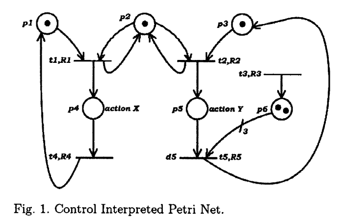

---

# 4. Metodología Petri-to-Ladder (Ecuación de Estado)
*   **Fundamento de Investigación Científica:**
    *   Método extraído del artículo presentado:
        *   **Congreso:** *IFAC Discrete-Event System Design, Gandia Beach, Spain, 2009*
        *   **Título:** *"Ladder diagram implementation of Control Interpreted Petri Nets: a state equation approach"*
        *   **Autores:** Marcos V. Moreira, Daniel S. Botelho y João C. Basílio.
        *   Garantiza la actualización atómica y elimina el "efecto avalancha" dividiendo la ejecución en dos fases estrictas (Evaluación y Actualización).

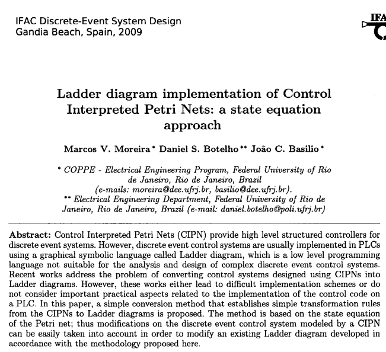

---

# 5. Estructura del Programa en 6 Módulos
*   **Módulo 0: Monitoreo de Seguridad:** Evaluación de la Seta de Emergencia (`I1.4` NC).
*   **Módulo 1: Inicialización:** Definición del marcado inicial ($M_0$) en el primer escaneo (`SM0.1`).
*   **Módulo 2: Eventos:** Captura y retención de flancos de sensores físicos.
*   **Módulo 3: Condiciones de Disparo:** Habilitación de transiciones según marcas y receptividades.
*   **Módulo 4: Dinámica de la Red:** Actualización atómica del marcado aplicando la ecuación de estado.
*   **Módulo 5: Acciones:** Mapeo de marcas de lugar activas a salidas físicas (nivel e impulso).

---

# Petri-to-Ladder: Módulo 0 (Monitoreo de Seguridad)
*   **Propósito:** Monitorear permanentemente la Seta de Emergencia (`I1.4` NC) en cada ciclo crítico del PLC.
*   **Lógica de Interlock:** Al activarse la emergencia (contacto abierto), se deshabilitan de inmediato las salidas físicas y marcas de habilitación, protegiendo mecánicamente los actuadores.

<p align="center">
  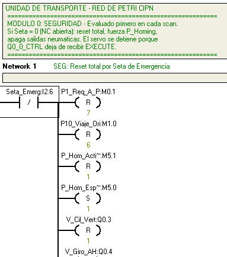
</p>

---

# Petri-to-Ladder: Módulo 1 (Inicialización)
*   **Propósito:** Establecer el marcado inicial de la red ($M_0$) durante el primer ciclo de escaneo de la CPU.
*   **Implementación:** Se utiliza la marca especial `SM0.1` para energizar bobinas `SET` de los lugares iniciales seguros (ej. estado de Homing o Reposo).

<p align="center">
  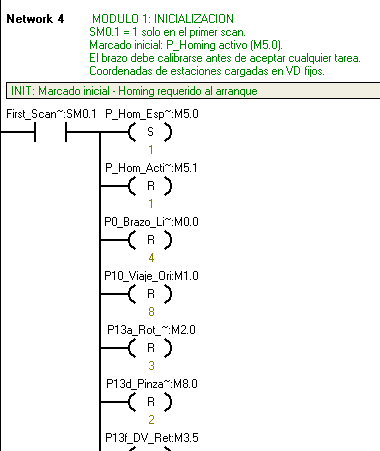
</p>

---

# Petri-to-Ladder: Módulo 2 (Eventos)
*   **Propósito:** Capturar de forma estable los flancos físicos de los sensores de campo.
*   **Implementación:** Mapea el cambio de estado de las señales (sensores inductivos, ópticos, de fibra) en marcas internas (`M2.x`), reteniéndolas durante el ciclo actual.

<p align="center">
  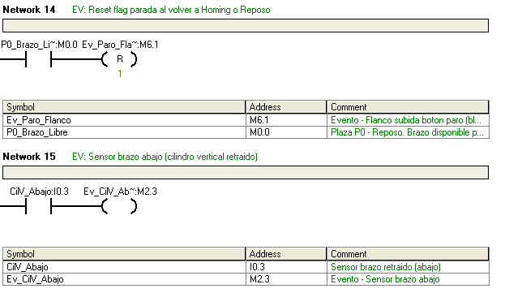
</p>

---

# Petri-to-Ladder: Módulo 3 (Condiciones de Disparo)
*   **Propósito:** Evaluar la habilitación de transiciones según receptividades físicas y marcas disponibles.
*   **Implementación:** Vincula en serie los lugares de entrada (NO) con los eventos detectados. Gestiona prioridades para evitar conflictos lógicos y temporizaciones de retardo.

<p align="center">
  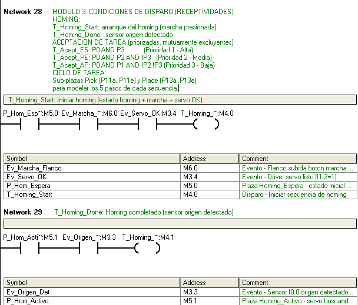
  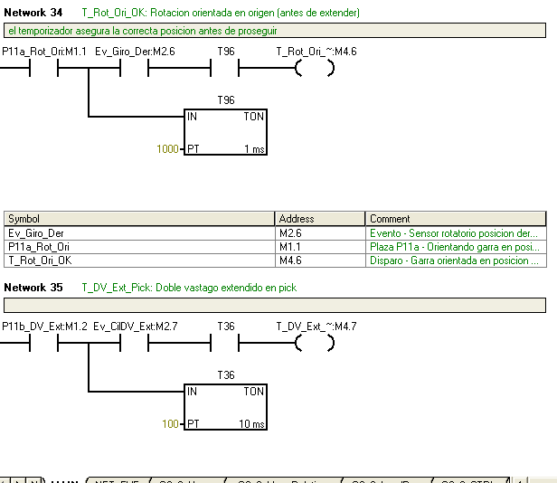
</p>

---

# Petri-to-Ladder: Módulo 4 (Dinámica de la Red)
*   **Propósito:** Actualización atómica de marcas aplicando la ecuación de estado de Petri en Ladder.
*   **Implementación:** Cada transición habilitada realiza un `RESET` del lugar origen y un `SET` del lugar destino en paralelo, impidiendo el "efecto avalancha".

<p align="center">
  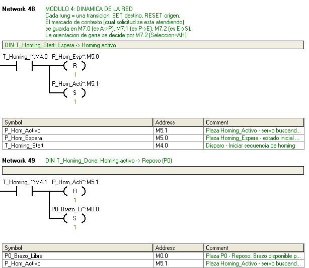
</p>

---

# Petri-to-Ladder: Módulo 5 (Acciones)
*   **Propósito:** Asignar los estados internos de los lugares de la red a las salidas físicas del PLC.
*   **Implementación:**
    *   *Acciones de Nivel:* Asocian directamente el contacto del lugar a la bobina física.
    *   *Acciones de Impulso:* Utilizan variables binarias de control para deshabilitar la salida tras un único ciclo.

<p align="center">
  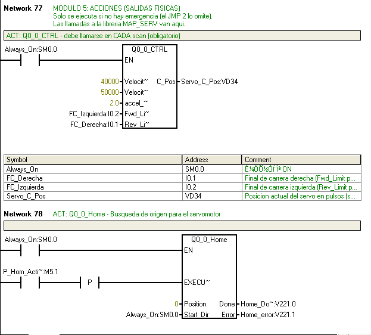
  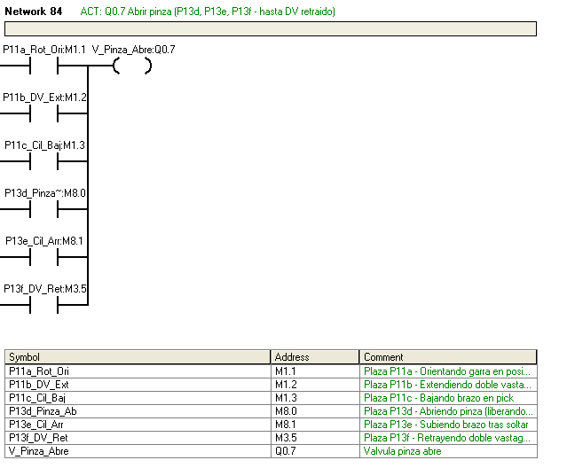
</p>

---

# 6. Redes Industriales y Handshake inter-PLC
*   **Doble Red Industrial RS-485 (19.2 kbps):**
    *   **Red Local PPI (19.2 kbps):** Comunicación inter-PLC uniendo los chasis en Daisy Chain. La **Unidad de Transporte actúa como maestro** y coordina los PLCs esclavos.
    *   **Red Modbus RTU (19.2 kbps):** Conecta al PLC Maestro (Unidad de Transporte) con la PC para la supervisión y adquisición en la interfaz web.
*   **Protocolo de Coordinación (Handshake):**
    1.  *Petición (Request):* La esclava avisa que tiene pieza lista.
    2.  *Habilitación (Grant):* El Coordinador autoriza inicio si el carro está posicionado.
    3.  *Fin de Ciclo (Done):* La esclava notifica término.
    *   Mapeo de red gestionado vía instrucciones `NETR`/`NETW`.

---

# 7. Topología de la Red Industrial (Bired)
<p align="center">
  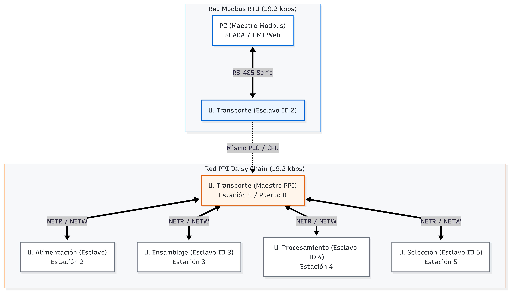
</p>

---

# 8. Servidor SCADA Multihilo Concurrente
*   **Exclusión Mutua (`modbus_lock`):** Evita colisiones de datos en el bus físico serie RS-485 (semidúplex) serializando las consultas Modbus RTU de múltiples clientes Flask concurrentes.
*   **Lectura en Bloque:** Optimiza la latencia leyendo 19 registros holding de una sola vez.

```python
# Mutex de exclusión mutua para el canal serie RS-485
modbus_lock = threading.Lock()

with modbus_lock:
    # Consulta en bloque único contiguo para reducir el ciclo a <50ms
    datos = instrumento.read_registers(0, 19)
```

---

# 9. Base de Datos SQLite y Locks de Concurrencia
*   **Exclusión Mutua SQL (`db_lock`):** Protege el archivo `piezas.db` contra escrituras/lecturas paralelas desde hilos Flask concurrentes (`threaded=True`).
*   **Timeout extendido:** Los hilos en cola esperan hasta 10 segundos antes de lanzar excepciones.

```python
# Mutex para evitar excepciones "database is locked"
db_lock = threading.Lock()

with db_lock:
    conn = sqlite3.connect("piezas.db", timeout=10.0)
    # Transacción segura de escritura del evento
```

---

# 10. Trazabilidad FDA 21 CFR Parte 11
*   **Control de Acceso basado en Roles (RBAC):** Restringe la modificación de las coordenadas de las estaciones en el área `V` del PLC (`VD10`-`VD22`) exclusivamente al rol `Ingeniero`.
*   **Audit Trail:** Historial inalterable con marcas de tiempo en base de datos.

```python
# Validación en backend mediante cabeceras HTTP (RBAC)
rol = request.headers.get("X-User-Role")
if rol != "Ingeniero" and request.path == "/api/consigna":
    abort(403) # Acceso denegado

guardar_auditoria(usuario, "CAMBIO_CONSIGNA", f"Nueva pos: {valor}")
```

---

# 11. Seguridad Física e Interlock por Software
*   **Lectura Prioritaria de Parada:** Polling constante de la entrada física `I1.4` (Discrete Input Modbus 12).
*   **Bloqueo por Software:** Si se abre el circuito de la Seta (valor `0`), el backend Flask inhabilita dinámicamente cualquier petición HTTP de marcha.

```python
# Interlock de seguridad por software redundante
seta_ok = leer_seta_modbus() # Lee I1.4 (Modbus Coil 12)
if seta_ok == 0:
    bloquear_escrituras_plc()
    return jsonify({"error": "Seta de emergencia activa"}), 400
```

---

# 12. Pantalla Principal de la Interfaz HMI/SCADA Web
*   **Visualización Remota Centralizada:**
    *   La nueva interfaz web basada en Flask relega por completo al HMI táctil local legacy MCGS.
    *   Permite visualizar el estado en tiempo real de cada cilindro, presencia de pieza y posiciones del servo en cuentas, facilitando la supervisión a múltiples clientes de forma concurrente.

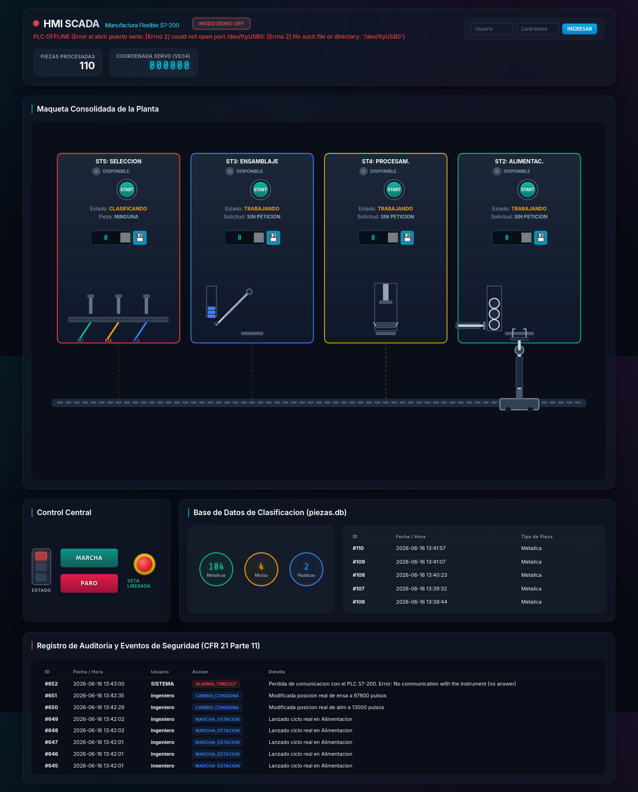

---

# 13. Conclusiones y Competencias Profesionales
*   **Mapeo Formal de Secuencias:** Mapeo de Redes de Petri CPN a diagramas Ladder mediante ecuaciones de estado para erradicar el efecto avalancha.
*   **Comunicaciones Industriales Robustas:** Programación y cableado físico de buses de campo en red local mediante red PPI y Modbus RTU.
*   **Desarrollo SCADA Web de Alta Precisión:** Implementación de servidores web Flask tolerantes a peticiones concurrentes y bases de datos seguras.
*   **Cumplimiento Normativo y Seguridad:** Integración de políticas de control de acceso por roles, registros históricos (CFR 21) e interlocks por hardware y software redundantes.
