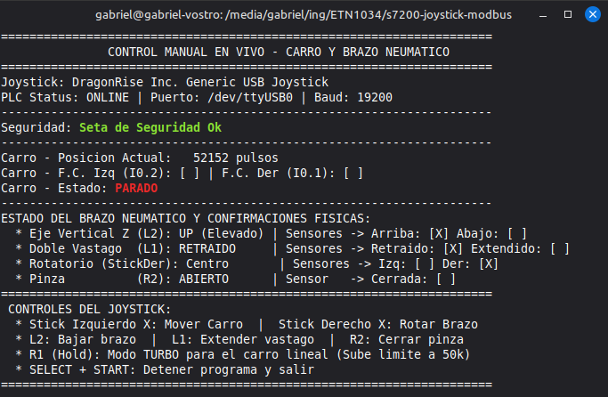

# s7200-joystick-modbus

Este repositorio contiene una solucion de control manual continuo para la **Estacion de Transporte** (cinta transportadora lineal y brazo robotico neumatico de pick-and-place) utilizando un **Joystick USB generico (DragonRise)** y un **PLC Siemens S7-200 (CPU 224XP)** a traves de comunicacion serie **Modbus RTU**.

El sistema actua mediante un script en la PC (Python) que lee las entradas analogicas y botones del joystick en tiempo real, las empaqueta y las envia mediante Modbus RTU al PLC, el cual se encarga del control directo de potencia, trayectorias y logica de seguridad fisica.



---

## Características Principales

*   **Control Proporcional de la Cinta:** Modulacion continua de la velocidad del servo (1000 a 50000 pulsos/s) utilizando el **Stick Izquierdo (Eje X)**.
*   **Modo Turbo / Precision:** El boton **R1** actua como modificador dinamico elevando la velocidad maxima disponible de 20k a 50k pulsos/s.
*   **Giro del Brazo Separado:** Control discreto del actuador rotatorio de la estacion con el **Stick Derecho (Eje X)**.
*   **Control Completo del Brazo Neumatico:**
    *   **L2:** Bajar eje vertical Z (valvula ON cuando se sostiene, reposo ARRIBA por seguridad).
    *   **L1:** Extender doble vastago.
    *   **R2:** Cerrar pinza de sujecion (reposo ABIERTA por defecto).
*   **Control de Marcha Inter-Estaciones (Red PPI):** Permite dar marcha de forma individual a las otras estaciones del laboratorio usando la **Botonera Derecha** del joystick:
    *   **Boton 1 (X):** Solicitud marcha Unidad de Alimentacion (`V1.1`).
    *   **Boton 2 (Circle):** Solicitud marcha Unidad de Procesamiento (`V3.1`).
    *   **Boton 3 (Square):** Solicitud marcha Unidad de Ensamblaje (`V5.1`).
    *   **Boton 4 (Triangle):** Solicitud marcha Unidad de Seleccion (`V7.1`).
    *   *Nota: La comunicacion y los acuses de recibo (handshakes) se sincronizan automaticamente sobre la red PPI mediante llamadas a `NET_EXE` (`SBR8`) y se limpian al recibir la confirmacion de arranque de cada unidad.*
*   **Telemetria de Red Completa:** El dashboard interactivo de la terminal muestra en tiempo real si cada unidad esta disponible/online y el estado activo de su secuencia.
*   **Filtro de Fines de Carrera Inteligente:** Si el carro golpea un fin de carrera (`I0.1` o `I0.2`), la funcion `Q0_0_CTRL` detiene el movimiento en esa direccion, pero permite arrancar y desplazarse en sentido opuesto usando el joystick, evitando tener que mover el carro de forma manual.
*   **Optimizacion de Memoria (Sin Colisiones):** La coordenada de posicion del servo (`Servo_C_Pos`) se reubico en **`VD40`** para evitar la superposicion mecanica de registros con los bytes de la red PPI (`VB0` a `VB7`), garantizando la integridad de las lecturas y la estabilidad del posicionador.
*   **Seguridad por Hardware Integrada:** La seta de emergencia (`I2.6` NC) y boton de paro desactivan directamente las salidas en el PLC, forzando la retraccion de los vastagos, la apertura de la pinza y la elevacion del eje vertical Z de forma autonoma y segura.

---

## Estructura del Repositorio

*   `joystick_transporte.awl`: Archivo de programa del PLC en formato AWL. Incluye la maquina de estados de giro seguro (Standstill-reversion), limites de carrera direccionales y llamadas a las funciones de posicionamiento (`MAP_SERV`) y Modbus.
*   `variables_joystick.csv`: Tabla de simbolos del programa del PLC para importar directamente en Step 7-Micro/WIN.
*   `joystick_control.py`: Puente de control en tiempo real en Python. Establece la conexion Modbus RTU, lee el control USB y actualiza la consola en tiempo real (flicker-free).
*   `test_joystick.py`: Simulador/diagnostico local offline para verificar la respuesta del joystick y los valores de registro antes de conectar el hardware del PLC.
*   `requirements.txt`: Lista de dependencias del entorno de Python.

---

## Requisitos de Hardware

1.  PLC Siemens S7-200 (CPU 224XP CN o equivalente).
2.  Cable convertidor USB a RS-485 (conectado a la PC en `/dev/ttyUSB0` o el puerto correspondiente).
3.  Joystick USB generico dual-stick (ej. DragonRise Inc. Generic USB Joystick).
4.  Estacion de Transporte (Cinta transportadora servo asistida y brazo neumatico).

---

## Configuracion y Puesta en Marcha

### 1. Carga del programa en el PLC
1.  Abra su proyecto en **Step 7-Micro/WIN**.
2.  Importe la tabla de variables desde `variables_joystick.csv` en el editor de simbolos.
3.  Importe el archivo de codigo `joystick_transporte.awl` en el bloque de organizacion principal (`OB1/MAIN`).
4.  Asegurese de que la memoria de biblioteca de Modbus este asignada lejos del rango ocupado (ej. a partir de `VB1000`).
5.  Cargue el programa al PLC y coloquelo en modo **RUN**.

### 2. Preparacion del Entorno en la PC
Instale las dependencias de Python necesarias:
```bash
# Crear entorno virtual
python3 -m venv venv
source venv/bin/activate

# Instalar dependencias
pip install -r requirements.txt
```

*Nota: Si se encuentra en Linux y recibe un error de permisos con el puerto serie, recuerde otorgar accesos ejecutando:*
```bash
sudo chmod 666 /dev/ttyUSB0
```

### 3. Modo Analogico del Joystick
Asegurese de que el boton **ANALOG** de su control de juegos este activado (LED rojo encendido) para que el Stick Derecho sea reconocido de forma independiente al Stick Izquierdo y el D-Pad.

### 4. Ejecucion del Control
Conecte el cable Modbus, el control USB y ejecute:
```bash
venv/bin/python joystick_control.py
```
Utilice la pantalla interactiva de la terminal (libre de parpadeos) para verificar el estado de los sensores y la telemetria en tiempo real. Para salir del control de forma segura, presione **SELECT + START** en el joystick simultaneamente.
